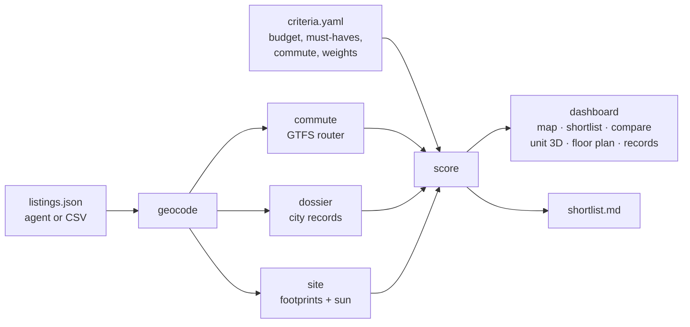

<h1 align="center">ApartmentScout</h1>

<p align="center"><b>Deep apartment research for you and your AI agent.</b><br>
Rank every listing on your own criteria, map door-to-door commutes, pull building violations and
311 complaints, read the reviews, and model the light and view from the exact unit before you sign.</p>

<p align="center">
<a href="#quick-start">Quick start</a> ·
<a href="#use-it-with-an-ai-agent">Agents</a> ·
<a href="#what-you-get">Features</a> ·
<a href="#gallery">Gallery</a> ·
<a href="docs/guides/methodology.md">Methodology</a> ·
<a href="docs/guides/new-city.md">Other cities</a> ·
<a href="docs/GALLERY.md">Full gallery</a>
</p>


ApartmentScout came out of a real search for a one-bedroom in Manhattan. That search tracked 732
listings across 600 buildings and needed the same questions answered for every finalist: what does
it really cost a month, how long is the commute, what do the city's records and the tenants say about
the building, how loud is the street, and will the window see the sky or a brick wall. This repo turns
that process into a toolkit anyone can run in any city, with that search included as a worked example.

## What you get

| | |
|---|---|
| **Agent playbooks** | `AGENTS.md`, `CLAUDE.md` and nine skills that walk Claude, Codex or any coding agent through intake, sourcing, records, reviews, noise, light, lease terms, tours and the final decision. |
| **Your criteria, your weights** | Budget tiers judged on true monthly cost (net-effective rent plus every fee), must-haves, preferences, commute limits and weights in one `criteria.yaml`. Unknown facts are shown as uncertainty instead of being guessed. |
| **Commute heatmaps** | A built-in GTFS transit router computes door-to-door minutes on a 150 m grid and for every listing, for any city that publishes a GTFS feed. No API keys. |
| **Building dossiers** | For NYC, one command pulls PLUTO, HPD violations and complaints, DOB and ECB records, construction permits on the block, bedbug filings, 311 noise and nearby crime. Elsewhere, the agent skill shows how to find the equivalents. |
| **Noise maps** | A city-wide 311 noise density layer, plus hour-of-day profiles for each building. |
| **3D sun and view** | Real building footprints and heights around the unit, live sun and shadows for any date and time, the view from the window, a sun-path chart against the skyline, and direct-sun hours for every floor and month. |
| **3D floor plans** | A simple JSON plan becomes a 3D apartment with sun patches through the windows, blocked by the neighbouring buildings. |
| **A dashboard you own** | A dark-first static web app with map, shortlist, compare, Unit 3D, floor plan and records views. Serve it locally, host it on GitHub Pages, or build one self-contained HTML file that opens anywhere. No server, account or API key. |

## Quick start

```bash
git clone https://github.com/<your-username>/ApartmentScout.git
cd ApartmentScout
pip install -e .

# see the worked example (732 Manhattan listings)
apartmentscout serve --search examples/nyc-2026

# start your own search
apartmentscout init searches/my-search --city nyc      # leave off --city outside New York
export APARTMENTSCOUT_SEARCH=searches/my-search
# edit searches/my-search/criteria.yaml, then add listings (CSV, JSON or your agent)
apartmentscout import my-listings.csv
apartmentscout all                                     # geocode, commute, layers, score, build
apartmentscout dossier                                 # building records for your shortlist
apartmentscout site <listing-id> --floor 12 --charts   # 3D site model, sun and view
apartmentscout serve                                   # open the dashboard
apartmentscout build --standalone my-search.html       # or one self-contained file you can double-click
```

Requires Python 3.10+. Everything built in uses free public data: NYC Open Data, the US Census
geocoder, OpenStreetMap and transit agencies' GTFS feeds.


## Use it with an AI agent

Open the repo in Claude Code, Claude Cowork, Codex, Cursor or any agent that reads `AGENTS.md`, and
ask in plain language:

> I'm moving to Chicago in March. Find me a one-bedroom with in-unit laundry under $2,600 within
> 30 minutes of the Loop by train, and tell me which buildings have problems.

The agent reads [`AGENTS.md`](AGENTS.md), interviews you for anything missing, writes your
`criteria.yaml`, and works through the skills in [`.claude/skills/`](.claude/skills):

| Skill | What the agent does |
|---|---|
| [`apartment-search`](.claude/skills/apartment-search/SKILL.md) | Intake, orchestration, scoring and shortlist |
| [`listing-sourcing`](.claude/skills/listing-sourcing/SKILL.md) | Sweeps portals, broker and building sites; captures and de-duplicates units |
| [`building-dossier`](.claude/skills/building-dossier/SKILL.md) | Public records, ownership, and reviews across Google, Yelp, Reddit, Openigloo and more |
| [`noise-deep-dive`](.claude/skills/noise-deep-dive/SKILL.md) | 311 patterns by hour and side of building, construction permits, a night-visit test plan |
| [`unit-light-and-view`](.claude/skills/unit-light-and-view/SKILL.md) | Finds the exposure (even from listing video landmarks) and runs the 3D sun and view study |
| [`floor-plan-model`](.claude/skills/floor-plan-model/SKILL.md) | Turns a listing plan into a 3D model with sun patches |
| [`commute-analysis`](.claude/skills/commute-analysis/SKILL.md) | Sets up destinations and GTFS feeds and checks the router against a live planner |
| [`lease-and-fees`](.claude/skills/lease-and-fees/SKILL.md) | Net-effective rent, fees, concessions, stabilisation, renewal and break terms |
| [`tour-and-decide`](.claude/skills/tour-and-decide/SKILL.md) | Tour checklists, night checks, comparison and a decision memo |

The skills are plain Markdown, so agents that do not support skills can still read them.
The agent drafts messages to leasing offices; it does not send them for you.

## How it works



Read the [methodology](docs/guides/methodology.md) for the scoring formula, the commute model, the sun
and skyline model and what each one leaves out.

## Gallery

All screenshots come from the included example: a Manhattan one-bedroom search from fall 2026 with
a commute to an office near Grand Central.

### Map and heatmaps

<table>
<tr>
<td width="50%"><br><sub>311 noise complaints per year, 150 m cells (335,923 requests)</sub></td>
<td width="50%"><br><sub>Monthly cost per ft², interpolated from listings</sub></td>
</tr>
<tr>
<td><br><sub>Listing panel: cost, score breakdown, commute route, records flags, reviews</sub></td>
<td><br><sub>Light mode is one click away</sub></td>
</tr>
<tr>
<td><br><sub>Where the best-scoring listings cluster</sub></td>
<td align="center"><br><sub>Works on a phone</sub></td>
</tr>
</table>

### Shortlist and compare


### Unit 3D: sun, shadows and the view from the window


<table>
<tr>
<td width="50%"><br><sub>From the 12th-floor window: facades across the street, a slice of sky</sub></td>
<td width="50%"><br><sub>Same line, 21st floor: over the rooftops to Hudson Yards</sub></td>
</tr>
<tr>
<td><br><sub>December 21 at 12:30 pm: long winter shadows</sub></td>
<td><br><sub>A 22nd-floor unit in a taller tower gets 6 to 9 hours of sun all year</sub></td>
</tr>
<tr>
<td><br><sub>Sun paths against the skyline from the window</sub></td>
<td><br><sub>Direct-sun hours for every floor and month on that facade</sub></td>
</tr>
</table>

Static versions for reports, written by `apartmentscout site --charts`:

<table><tr>
<td width="60%"></td>
<td width="40%"></td>
</tr></table>

### Floor plan in 3D

<table>
<tr>
<td width="50%"><br><sub>Sun through the windows on the move-in date</sub></td>
<td width="50%"><br><sub>Top-down, June 21 at 5 pm</sub></td>
</tr>
</table>

### Building records


## More from the original search

The [gallery](docs/GALLERY.md) collects the one-off tools built during the search this repo came
from: the first search-dashboard prototype, two other light-and-view models, three 3D floor-plan and
furniture-fit studios, and the due-diligence reports. They are the design reference for where the
dashboard is heading.

<table><tr>
<td width="33%"><br><sub>First search-dashboard prototype</sub></td>
<td width="33%"><br><sub>Apartment layout studio</sub></td>
<td width="33%"><br><sub>Floor-plan fit check</sub></td>
</tr><tr>
<td><br><sub>Neighbourhood height model</sub></td>
<td><br><sub>Knox: what the windows can see</sub></td>
<td><br><sub>Room to live: furniture in 3D</sub></td>
</tr></table>

## The example search

[`examples/nyc-2026`](examples/nyc-2026) is a real search, lightly anonymised:

- 732 listings (430 active) in Manhattan with prices, amenities, review summaries and statuses.
- Commute heatmap to an office near Grand Central on the NYC subway timetable.
- A 12-month 311 noise layer for the whole area.
- 23 building dossiers from NYC Open Data.
- 3D site models for 8 shortlisted units and a 3D floor plan for one.
- Research notes from the deep dives (due diligence, noise ledger, orientation audit).

Listing photos are not included; links point to the original listings.

## Repository layout

```
AGENTS.md, CLAUDE.md        operating guide for AI agents
.claude/skills/             nine stage-by-stage playbooks
apartmentscout/             Python package and CLI
dashboard/                  static web dashboard (map, shortlist, compare, 3D, plans, records)
config/                     criteria template and city profiles
examples/nyc-2026/          worked example
templates/                  research note, landlord questions, tour checklist, decision memo
docs/guides/                getting started, data model, methodology, floor plans, new cities, dashboard
scripts/screenshots.py      regenerates every image in this README
tests/                      unit tests (pytest)
```

## Other cities

Commute heatmaps, 3D sun and view (OpenStreetMap buildings), floor plans, scoring and the dashboard
work anywhere. Building-records automation ships for New York City; elsewhere the agent researches
records by hand and [adding a city module](docs/guides/new-city.md) is a short Python file. City
profiles with transit feeds and landmark names are very welcome as pull requests.

## Privacy and responsible use

- Your searches live in `searches/`, which git ignores, so personal criteria and notes stay local
  unless you choose to publish them.
- Agents are told to respect site terms: no CAPTCHA solving, no bypassing bot protection, no
  logging in or contacting landlords without your say-so.
- 311 calls, complaints and reviews are reports, not findings. The dashboard and reports say so.
- Commute, sun and score numbers are estimates. Check the important ones in person.

## Contributing

Issues and pull requests are welcome, especially city profiles, records modules, GTFS feed lists
and better floor-plan tooling. Run `pytest` before opening a PR and `python scripts/screenshots.py`
if you change the dashboard.

## License

MIT. Data from the sources above remains under its own terms; OpenStreetMap data is © OpenStreetMap
contributors under the ODbL.
