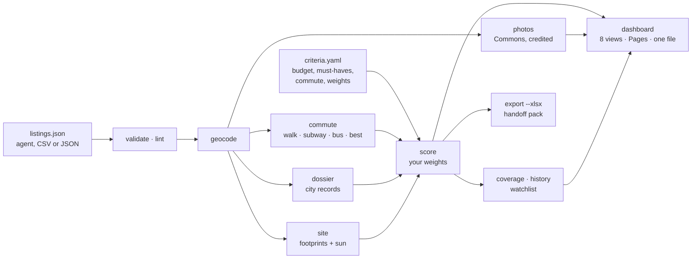

<h1 align="center">ApartmentScout</h1>

<p align="center"><b>Deep apartment research for you and your AI agent.</b><br>
Rank every listing on your own criteria, know the true monthly cost, time the commute by walking, subway
and bus, read the building's records, and see the light from inside the exact unit before you sign.</p>

<p align="center">
<a href="#quick-start">Quick start</a> ·
<a href="#use-it-with-an-ai-agent">Agents</a> ·
<a href="#what-you-get">Features</a> ·
<a href="#gallery">Gallery</a> ·
<a href="docs/guides/methodology.md">Methodology</a> ·
<a href="docs/guides/new-city.md">Other cities</a> ·
<a href="docs/GALLERY.md">Full gallery</a>
</p>


ApartmentScout came out of a real search for a one-bedroom in Manhattan: 738 listings in 600 buildings,
and the same questions for every finalist. What does it really cost a month once the fees and free
months are counted? How long is the trip door to door? What do the city's records and the tenants say
about the building? How loud is the street, and will the window see the sky or a wall? This repo turns
that process into agent playbooks, a Python CLI and a dashboard you own, for any city, with that search
included as a worked example.

## What you get

| | |
|---|---|
| **Agent playbooks** | `AGENTS.md`, `CLAUDE.md` and nine skills that walk Claude, Codex or any coding agent through intake, sourcing, records, reviews, noise, light, lease terms, tours and the final decision. Agents draft; they never send. |
| **Your criteria, live weights** | Budget tiers, must-haves, preferences, commute limits and ten scoring dimensions in one `criteria.yaml`. Pick a versioned weight preset, then drag any weight: every card, pin and rank (Fit, Action, Budget, Building) updates while you drag, with a plain-sentence "why it ranks here". |
| **An honest money model** | First-lease monthly cost, paid month, move-in cash and renewal from gross rent. Unknown fees stay unknown instead of becoming $0; free months without a lease term are shown as conditional; disputed prices become scenarios ranked on the conservative one. |
| **Commute by mode** | A built-in GTFS router gives door-to-door minutes by walking, subway, bus and best of transit (with subway and bus transfers), as a range across departures with leg-by-leg routes, plus heat maps on a 150 m grid. Checked against an independent router on 208 buildings: mean error 0.57 to 0.80 min by mode. No API keys. |
| **Building records** | For NYC, one command writes a due-diligence report per building: PLUTO facts, HPD violations and complaints, DOB and ECB records, permits on the block, bedbug filings, 311 noise by hour and nearby crime, each labelled as a report or a finding. Elsewhere the skill shows where to look. |
| **Research quality** | `validate` (schema, ranges, duplicates, URLs), `lint` (14 listing traps such as a "junior 1BR", building laundry sold as in-unit or a fee passed off as a price drop), `coverage` (a 15-fact finalist standard, what each gap could swing, questions to ask), `history` (append-only claims and snapshots) and a building watchlist. |
| **3D light and view** | Real footprints and heights around the unit, sun and shadows for any date and time, the view from the window and from inside the apartment, bay windows, the buildings that shade each window by name, filed and proposed towers, a sun path against the skyline, and direct-sun hours for every floor and month. |
| **Floor-plan studio** | A plan JSON becomes a synced 2D plan and 3D apartment with real sun patches. Place furniture from a 23-piece catalogue with cited sizes and get fit checks (overlaps, door swings, clearances, TV distance), layout presets, eye-level cameras, and PNG and GLB export. |
| **Building photos** | `apartmentscout photos` finds freely licensed Wikimedia Commons photos of each building under strict matching rules and keeps the author and licence with every image. Without one, the dashboard shows an aerial view of the building. |
| **Spreadsheet export** | `export --xlsx` writes a workbook whose Weights sheet drives live SCORE and RANK formulas, with outreach, to-verify, upfront-charges and sources sheets. `--csv` too, both guarded against formula injection. |
| **Agent handoff kit** | `handoff pack / verify / import` moves a search between agents as checksummed packs. Imports append claims, keep conflicts on disk and never let an older claim overwrite a newer fact. |
| **A dashboard you own** | Eight views: Map, Shortlist, Compare, Unit 3D, Floor plan, Records, Research and Tours. Dark first with a light theme, works on a phone. Serve it locally, host it on GitHub Pages, or build one self-contained HTML file. No server code, accounts or API keys. |

## Quick start

```bash
git clone https://github.com/<your-username>/ApartmentScout.git
cd ApartmentScout
pip install -e .                                       # ".[xlsx]" adds the workbook export, ".[dev]" the test tools

# see the worked example (732 Manhattan listings)
apartmentscout serve --search examples/nyc-2026

# start your own search
apartmentscout init searches/my-search --city nyc      # leave off --city outside New York; add --interactive to be asked
export APARTMENTSCOUT_SEARCH=searches/my-search
# edit searches/my-search/criteria.yaml, then add listings (CSV, JSON or your agent)
apartmentscout import my-listings.csv
apartmentscout validate && apartmentscout lint         # catch bad data and listing traps early
apartmentscout all                                     # geocode, commute by mode, layers, score, build
apartmentscout coverage                                # what is still unknown, and what it could swing
apartmentscout dossier                                 # building records for your shortlist (NYC)
apartmentscout photos                                  # licensed building photos with credits
apartmentscout site <listing-id> --floor 12 --charts   # 3D site model, sun and view
apartmentscout export --xlsx my-search.xlsx            # workbook with live weights and ranks
apartmentscout handoff pack out.zip --to codex         # hand the search to another agent
apartmentscout serve                                   # open the dashboard
apartmentscout build --standalone my-search.html       # or one self-contained file you can double-click
```

Requires Python 3.10+. Everything built in uses free public data: NYC Open Data, the US Census geocoder,
OpenStreetMap, Wikimedia Commons and transit agencies' GTFS feeds.


## Start a new search

Three ways in, one `criteria.yaml`. They ask the same questions in the same order
([`config/intake.yaml`](config/intake.yaml): each has a why, a default and the key it sets), so you can mix them.

- **In the app.** Run `apartmentscout serve`, open the search switcher in the top bar and choose *New search*
  (also `?new=1`, and the search box's *New search* command). A step-by-step wizard sets the basics, places (click
  the map to drop a pin), money, home size, amenities, building and interior taste, and ranking weights, checks
  every field as you type, keeps a draft if you close it, and ends in a review with the criteria.yaml and a diff
  against the search you have open. Served locally it creates the search folder or saves `criteria.yaml` for you
  (the old file is backed up) and can re-score in place; on GitHub Pages or a standalone file it downloads or
  copies the file and the commands instead.
- **With an agent.** Ask it to start a search: it follows the same questionnaire, shows you what it heard, and
  writes the file with `apartmentscout init searches/<name> --criteria answers.yaml`.
- **In the terminal.** `apartmentscout init searches/my-search --city nyc --interactive` asks the questions with
  defaults you can accept with Enter. Anywhere: `apartmentscout criteria --check criteria.yaml` validates a file and
  prints a summary.

## Use it with an AI agent

Open the repo in Claude Code, Claude Cowork, Codex, Cursor or any agent that reads `AGENTS.md`, and
ask in plain language:

> I'm moving to Chicago in March. Find me a one-bedroom with in-unit laundry under $2,600 within
> 30 minutes of the Loop by train, and tell me which buildings have problems.

The agent reads [`AGENTS.md`](AGENTS.md), interviews you for anything missing, writes your
`criteria.yaml`, and works through the skills in [`.claude/skills/`](.claude/skills):

| Skill | What the agent does |
|---|---|
| [`apartment-search`](.claude/skills/apartment-search/SKILL.md) | Intake, orchestration, scoring and shortlist |
| [`listing-sourcing`](.claude/skills/listing-sourcing/SKILL.md) | Sweeps portals, broker and building sites; captures and de-duplicates units |
| [`building-dossier`](.claude/skills/building-dossier/SKILL.md) | Public records, ownership, and reviews across Google, Yelp, Reddit, Openigloo and more |
| [`noise-deep-dive`](.claude/skills/noise-deep-dive/SKILL.md) | 311 patterns by hour and side of building, construction permits, a night-visit test plan |
| [`unit-light-and-view`](.claude/skills/unit-light-and-view/SKILL.md) | Finds the exposure (even from listing video landmarks) and runs the 3D sun and view study |
| [`floor-plan-model`](.claude/skills/floor-plan-model/SKILL.md) | Turns a listing plan into a plan JSON for the floor-plan studio, with fit checks and sun patches |
| [`commute-analysis`](.claude/skills/commute-analysis/SKILL.md) | Sets up destinations and GTFS feeds, computes walk / subway / bus / best and checks them against a live planner |
| [`lease-and-fees`](.claude/skills/lease-and-fees/SKILL.md) | Net-effective rent, fees, concessions, stabilisation, renewal and break terms |
| [`tour-and-decide`](.claude/skills/tour-and-decide/SKILL.md) | Tour checklists, night checks, comparison and a decision memo |

Between stages the agent runs `validate`, `lint` and `coverage`, so bad data, listing traps and the
facts that would change the ranking surface before you spend a visit on them. The skills are plain
Markdown, so agents that do not support skills can still read them. The agent drafts messages to
leasing offices; it does not send them for you. Two agents can share one search through
[handoff packs](docs/guides/agents-handoff.md).

## How it works



Every stage is a CLI command over plain files in your search folder, so you, your agent or a
spreadsheet can step in anywhere. Read the [methodology](docs/guides/methodology.md) for the money
model, the scoring formula, the commute router and its validation, the sun and skyline model and what
each one leaves out.

## Gallery

Every screenshot comes from the included example: a Manhattan one-bedroom search from fall 2026 with a
commute to a Midtown office near Grand Central. The [full gallery](docs/GALLERY.md) has more.

### Map

<table>
<tr>
<td colspan="2"><br><sub>The listing drawer: a credited Commons photo of the building, monthly cost against gross rent and move-in cash, unknown fees left unknown, headroom in each budget tier and why it ranks where it does</sub></td>
</tr>
<tr>
<td width="50%"><br><sub>Tilt into 3D buildings over the commute bands, subway lines and stations</sub></td>
<td width="50%"><br><sub>Commute by mode: best, subway, bus and walk, the route leg by leg, records flags as reports, what residents say and the open questions</sub></td>
</tr>
<tr>
<td><br><sub>311 noise complaints per year in 150 m cells (335,923 requests)</sub></td>
<td><br><sub>The light theme is one key away (<kbd>t</kbd>)</sub></td>
</tr>
<tr>
<td align="center" colspan="2"><br><sub>On a phone: the map on top, ranked cards below</sub></td>
</tr>
</table>

### Shortlist, Compare, Research and Tours


<sub>Shortlist: ranked live by your weights, with monthly cost, budget tier, $/ft², commute, floor, laundry, doorman and gym (? means unconfirmed), score and how much of the score rests on known facts.</sub>

<table>
<tr>
<td width="50%"><br><sub>Research: the finalist standard, missing and stale facts, the points each listing has at stake and copyable questions for the leasing office</sub></td>
<td width="50%"><br><sub>Every image in one place: licensed building photos with author and licence, floor plans and aerial fallbacks</sub></td>
</tr>
<tr>
<td><br><sub>Tours: picks tiered S, A, B, C or Pass, tour times and notes, and a nearest-next route from the office</sub></td>
<td><br><sub>Compare: four finalists with the best value in each row marked, unknowns that never count as the worst, scores per dimension and cost against space</sub></td>
</tr>
</table>

### Unit 3D: light and view


<sub>Emerald Green 1211 among its real neighbours: units in the building with compass dials, provenance chips, towers under construction drawn dashed, and a day strip comparing floor 12 with floor 21 on October 15.</sub>

<table>
<tr>
<td width="50%"><br><sub>From the 12th-floor window at 1 pm: in the shadow of 326 West 37th Street, with a slot of sky</sub></td>
<td width="50%"><br><sub>Same line, 21st floor: direct sun, One Manhattan West, and a permitted tower drawn where it will stand</sub></td>
</tr>
<tr>
<td><br><sub>Inside the apartment: the plan's walls and windows at the real slab height, with the sun patch on the floor</sub></td>
<td><br><sub>North-up plan camera: the window, its block and the filed new buildings nearby</sub></td>
</tr>
<tr>
<td><br><sub>December 21 at 12:30 pm: long winter shadows</sub></td>
<td><br><sub>Another building, 22nd floor, 7:30 pm on June 21: Hudson Yards with proposed and rising towers outlined</sub></td>
</tr>
<tr>
<td><br><sub>Sun paths against the skyline from the window; dashed, the skyline from the compare floor</sub></td>
<td><br><sub>Direct-sun hours for every floor and month on that facade</sub></td>
</tr>
</table>

Static versions for reports, written by `apartmentscout site --charts`:

<table><tr>
<td width="60%"></td>
<td width="40%"></td>
</tr></table>

### Floor-plan studio

<table>
<tr>
<td width="68%"><br><sub>2D plan and 3D side by side: ten pieces placed and all clear, bed and sofa TV distances marked ideal, two layout presets written for this plan</sub></td>
<td width="32%"><br><sub>Top-down at 5 pm on June 21</sub></td>
</tr>
</table>

### Records


<sub>A due-diligence report for one building: PLUTO facts, record and street-noise scores, a "What matters" table with evidence and practical significance, monthly timelines of 311 and official records, noise by hour, ledgers and the research notes.</sub>

### More screens

<table>
<tr>
<td width="50%"><br><sub>Switch the commute lens to bus, subway, walk or best: heat map, pins, cards and tables follow</sub></td>
<td width="50%"><br><sub>Edit budget tiers, must-haves, move-in window and destinations in the app, with a preview before you apply</sub></td>
</tr>
<tr>
<td><br><sub>Every month, at signing and over the lease, with unknown fees left unknown</sub></td>
<td><br><sub>Sun on the window: blockers, possible vs expected hours, sky view and an estimated daylight factor</sub></td>
</tr>
<tr>
<td><br><sub>Unit 3D in the light theme, June evening</sub></td>
<td><br><sub>Floor plan light: per-window sun, glass and blinds, daylight per room</sub></td>
</tr>
<tr>
<td><br><sub>Trace a new plan from an image or PDF</sub></td>
<td><br><sub>Compare, light theme</sub></td>
</tr>
<tr>
<td><br><sub>Light theme with a listing open</sub></td>
<td align="center"> <br><sub>On a phone</sub></td>
</tr>
</table>

## The example search

[`examples/nyc-2026`](examples/nyc-2026) is a real search, lightly anonymised:

- 732 listings (430 active) in Manhattan with prices, amenities, review summaries and statuses.
- Walk, subway, bus and best-of-transit commutes with route legs for every listing, and heat maps to a
  Midtown office near Grand Central on the MTA timetables.
- 213 listings with licensed Wikimedia Commons building photos and their credits.
- A 12-month 311 noise layer for the whole area.
- 23 building dossiers from NYC Open Data.
- 3D site models for 8 shortlisted units and a v2 floor plan with furniture presets for one.
- Research notes from the deep dives (due diligence, noise ledger, orientation audit).
- Listing photos for 103 units (web-sized copies with links to the originals) and licensed Wikimedia Commons
  building photos with credits for 213; the rest show an aerial view.

## Repository layout

```
AGENTS.md, CLAUDE.md        operating guide for AI agents
.claude/skills/             nine stage-by-stage playbooks
apartmentscout/             Python package and CLI
dashboard/                  static web dashboard (eight views, no build step)
config/                     criteria template and city profiles
examples/nyc-2026/          worked example
templates/                  research note, landlord questions, tour checklist, decision memo
docs/guides/                getting started, dashboard, data model, methodology, research quality,
                            photos, floor plans, agent handoff, new cities
scripts/                    release_check.py, screenshots.py, bundle.sh
tests/                      pytest suite and node tests (tests/js)
```

## Other cities

Commute by mode, 3D sun and view (OpenStreetMap buildings), floor plans, photos, scoring, research
quality and the dashboard work anywhere. Building-records automation ships for New York City; elsewhere
the agent researches records by hand and [adding a city module](docs/guides/new-city.md) is a short
Python file. City profiles with transit feeds and landmark names are very welcome as pull requests.

## Privacy and responsible use

- Your searches live in `searches/`, which git ignores. `apartmentscout serve` exports a private search
  into that search's own cache and serves it from there, so personal criteria, notes and saved listing
  photos never land in tracked files.
- Photos are a per-search choice: `apartmentscout photos --cache` keeps copies in your search folder, and
  Commons building photos carry their licence and author. Listing photos belong to their owners.
- Agents are told to respect site terms: no CAPTCHA solving, no bypassing bot protection, no logging in
  or contacting landlords without your say-so.
- 311 calls, complaints and reviews are reports, not findings. The dashboard and reports say so.
- Commute, sun, money and score numbers are estimates, and coverage is of the listings you captured, not
  a market census. Check the important ones in person.
- Anything you publish (a Pages site, a standalone file, a workbook) shows your listings and notes to
  whoever has it. Run `python scripts/release_check.py` before you publish.

## Data and licences

ApartmentScout loads MapLibre GL, three.js and the Geist fonts, bundles d3-contour, and uses
OpenFreeMap and OpenStreetMap, Esri imagery, NYC Open Data, MTA GTFS feeds and Wikimedia Commons photos.
Each keeps its own licence and attribution requirements, summarised in
[THIRD_PARTY_NOTICES.md](THIRD_PARTY_NOTICES.md). Keep the map attribution visible on anything you
publish and show the credit line with every Commons photo.

## Contributing

Issues and pull requests are welcome, especially city profiles, records modules, GTFS feed lists and
better floor-plan tooling. Before opening a PR:

```bash
pip install -e ".[dev]"                # pytest, playwright (screenshots), openpyxl
pytest                                 # Python tests
node --test tests/js                   # dashboard logic tests
python scripts/release_check.py        # privacy, image manifest, ignore rules, photos, tests
python scripts/screenshots.py          # if you changed the dashboard (re-shoots docs/images)
```

After editing `dashboard/js/`, run `scripts/bundle.sh` to refresh the bundle that standalone builds embed.

## License

MIT. Data from the sources above remains under its own terms; see
[THIRD_PARTY_NOTICES.md](THIRD_PARTY_NOTICES.md).
