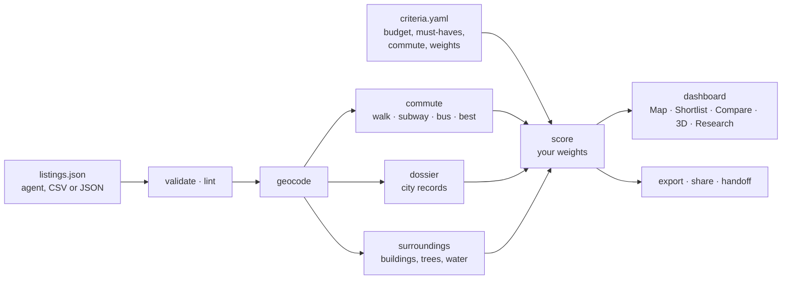

<h1 align="center">ApartmentScout</h1>

<p align="center"><b>Know the apartment before you sign.</b><br>
Rank every listing on your own criteria and its true monthly cost, time the commute, read the building's records, and stand
inside the exact unit, with your own furniture, in the real city around it.</p>

<p align="center">
<a href="LICENSE"></a>


</p>

<p align="center">
<a href="https://0marm0.github.io/ApartmentScout/demo/"><b>Try the demo</b></a> ·
<a href="#start-your-own-search">Start your own search</a> ·
<a href="#how-it-works">How it works</a> ·
<a href="docs/GALLERY.md">Gallery</a> ·
<a href="#documentation">Docs</a>
</p>


ApartmentScout came out of a real search for a one-bedroom in Manhattan: 738 listings in 260 buildings, and the same questions
for every finalist. What does it cost a month once fees and free months are counted? How long is the trip door to door? What do
the city's records say about the building? How loud is the street, and will the window see the sky or a wall? This repository
turns that process into agent playbooks, a Python command line and a dashboard you own, for any city, with that search included
as a worked example.

## What you get

<table>
<tr>
<td width="50%" valign="top"><br><b>Commute by walking, subway and bus</b><br>A built-in GTFS router gives door-to-door minutes for every home, heat maps on a 150 m grid, and the route drawn leg by leg when you hover a card.</td>
<td width="50%" valign="top"><br><b>The true monthly cost</b><br>Fees and free months counted, unknown fees left unknown, a price nobody read off the unit page marked "price unverified", and real price history behind every "price drop".</td>
</tr>
<tr>
<td valign="top"><br><b>Ask in plain words</b><br>"East of 3rd Ave under 5k with w/d" previews what it understood, with a count, before anything changes. Streets, parks, neighbourhoods and several destinations work.</td>
<td valign="top"><br><b>Light and view in 3D</b><br>Real footprints and heights, facades with lit windows at night, the Empire State and Chrysler Buildings drawn from their parts, street and park trees, grass and water, and direct sun for every floor and month.</td>
</tr>
<tr>
<td valign="top"><br><b>Step inside with your own furniture</b><br>A bright room at the real floor height, with the furniture you actually own, and the real city through the window. A "measured vs assumed" chip says what the picture rests on.</td>
<td valign="top"><br><b>Compare finalists</b><br>Up to four homes side by side on money, space, commute, building, light and score. The best value in each row is marked, and unknowns never count as the worst.</td>
</tr>
<tr>
<td valign="top"><br><b>Visit notes and a paper trail</b><br>Measure rooms, rate the noise and check the listing's claims on your phone at the home. Findings sit beside the listing's facts, and every decision is dated. Then the tour planner, a share page and a decision memo.</td>
<td valign="top"><br><b>Set up for any city</b><br>A wizard in the dashboard, an interview in the terminal, or your agent: any city OpenStreetMap knows, with its transit feed. The dashboard installs as an app and works offline.</td>
</tr>
</table>

More: agent playbooks for every stage, floor plans traced from a listing's PDF, a 311 noise layer and building records for New York,
licensed building photos with credits, a workbook whose weights drive live ranks, and checksummed handoff packs between agents.
The [full gallery](docs/GALLERY.md) walks through it in order: find, compare, see inside, decide, set up.

## Try the demo

The [live demo](https://0marm0.github.io/ApartmentScout/demo/) is the dashboard on the worked example, running in your browser:
738 Manhattan listings (434 active) in 260 buildings, commutes to an office near Grand Central, 16 3D site models, 9 floor plans
and 30 building dossiers. Install it from Chrome, Edge or Safari and it keeps working offline. To run it on your own machine:

```bash
git clone --depth 1 https://github.com/<your-username>/ApartmentScout.git   # --depth 1: today's files, not the whole history
cd ApartmentScout
python -m venv .venv && source .venv/bin/activate
pip install -e .                                       # ".[xlsx]" adds the workbook export, ".[dev]" the test tools
apartmentscout serve --search examples/nyc-2026
```

## Start your own search

From nothing to a ranked map in about 15 minutes, in any city ([the full walk-through](docs/guides/getting-started.md)). It asks for
your **city** (looked up, so the time zone and map are right), your **places** (addresses are found and confirmed) and your
**transit timetable** (a starter feed is offered where one has been checked):

<!-- quickstart -->
```bash
apartmentscout init searches/my-search --city "Chicago, IL" --interactive
export APARTMENTSCOUT_SEARCH=searches/my-search
apartmentscout import searches/my-search/listings.csv   # fill the listings.template.csv that init wrote, or ask your agent
apartmentscout validate && apartmentscout lint         # catch bad data and listing traps early
apartmentscout all                                     # geocode, commute by mode, layers, places, score, build
apartmentscout surroundings                            # fetch the buildings around each shortlisted home (3D, sun, view)
apartmentscout plans                                   # floor plans: which homes have one, and how to add one
apartmentscout serve                                   # open the dashboard on your own data
```

Prefer to click? Run `apartmentscout serve`, open the menu at the top right and choose *New search*: a wizard asks the same
questions and writes the same `criteria.yaml`. Prefer to talk? Open the repository in Claude Code, Codex or Cursor and say
"help me find a one-bedroom near X under $Y": the agent reads [`AGENTS.md`](AGENTS.md) and interviews you. Floor plans: in the
**3D** tab choose *Floor plan*, then *New plan from image*, trace the listing's PNG or PDF and *Save to the search folder*
([adding your floor plans](docs/guides/getting-started.md#7-adding-your-floor-plans)).

Requires Python 3.10+. Everything built in uses free public data: NYC Open Data, the US Census geocoder, OpenStreetMap, Wikimedia
Commons and transit agencies' GTFS feeds. Outside New York, building-records automation and the noise layer are not built in
(`apartmentscout city` shows what your city has); [adding a city profile](docs/guides/new-city.md) is a short YAML file.

## How it works

Three parts, all yours, all plain files in a folder. No account, server or API key sits between you and your data.

| | What it does |
|---|---|
| **Your agent** | Open the repository in Claude Code, Codex, Cursor or any agent that reads `AGENTS.md`. Nine skills in [`.claude/skills/`](.claude/skills) walk it through intake, listing sourcing, commutes, building dossiers, noise, light and view, floor plans, lease and fees, and tours. It checks its own data with `validate`, `lint` and `coverage`, and it drafts messages to leasing offices without sending them. |
| **The CLI** | Every stage is one command over files in your search folder: `geocode`, `commute`, `dossier`, `surroundings`, `score`, `build`, `export`, `share`. Repeatable, scriptable, and offline once the data is pulled. |
| **The dashboard** | Map, Shortlist, Compare, 3D and Research in one static page with one menu. Serve it, host it on GitHub Pages, open it as a single HTML file, or install it as an app. |



The [methodology](docs/guides/methodology.md) covers the money model, the scoring formula, the commute router and its validation,
and the sun and skyline model, and says what each one leaves out. The [agent guide](AGENTS.md) is the operating manual.

## Gallery

<table>
<tr>
<td width="33%"><a href="docs/GALLERY.md#find"></a><br><sub><b>Find</b>: the map, the money, the photos</sub></td>
<td width="33%"><a href="docs/GALLERY.md#see-inside"></a><br><sub><b>See inside</b>: Unit 3D, day and night</sub></td>
<td width="33%"><a href="docs/GALLERY.md#decide"></a><br><sub><b>Decide</b>: visits, tours and the memo</sub></td>
</tr>
</table>

The full gallery, [organised by the journey](docs/GALLERY.md): Find, Compare, See inside, Decide, Set up. Every image comes from the
included example, a Manhattan one-bedroom search from fall 2026, and every caption says what the image shows.

## Documentation

| | |
|---|---|
| Start | [Getting started](docs/guides/getting-started.md) · [The dashboard](docs/guides/dashboard.md) · [Other cities](docs/guides/new-city.md) |
| How it is computed | [Methodology](docs/guides/methodology.md) · [Data model](docs/guides/data-model.md) · [Research quality](docs/guides/research-quality.md) · [Leasing-office questions](docs/guides/leasing-office-questions.md) |
| 3D and photos | [Floor plans](docs/guides/floor-plans.md) · [Photos](docs/guides/photos.md) |
| Agents | [AGENTS.md](AGENTS.md) · [Skills](.claude/skills) · [Agent handoff](docs/guides/agents-handoff.md) · [Monitoring](docs/guides/monitoring.md) |
| Project | [Roadmap](docs/ROADMAP.md) · [Release checklist](docs/RELEASE_CHECKLIST.md) · [Design system](docs/design/design-system.md) |

More commands, once you have finalists:

```bash
apartmentscout coverage                                # what is still unknown, and what it could swing
apartmentscout dossier                                 # building records for your shortlist (NYC; elsewhere the building-dossier skill)
apartmentscout photos                                  # licensed building photos with credits
apartmentscout site <listing-id> --floor 12 --charts   # one home's 3D site model, sun and view in detail
apartmentscout export --xlsx my-search.xlsx            # workbook with live weights and ranks
apartmentscout share --picks picks.json --out shortlist.html   # a read-only page (or --memo) of your saved picks
apartmentscout handoff pack out.zip --to codex         # hand the search to another agent
apartmentscout build --standalone my-search.html       # one self-contained file (after editing dashboard/js, run scripts/bundle.sh first; needs Node.js)
```

## The example search

[`examples/nyc-2026`](examples/nyc-2026) is a real search, lightly anonymised: 738 listings (434 active) in 260 Manhattan buildings
with prices, amenities, review summaries and statuses; walk, subway, bus and best-of-transit commutes to a Midtown office near
Grand Central on the MTA timetables; a 311 noise layer; 30 building dossiers from NYC Open Data; 16 3D site models and 9 floor
plans with a furnished layout; and saved photos for 286 homes, with an aerial view where a home has none.

**Photos.** The full set is 5,595 photos (about 400 MB), so it is not in the download. The repository carries a 34 MB starter
set, [`examples/nyc-2026/media-lite`](examples/nyc-2026/media-lite): a real gallery (up to 30 photos) for each of the twelve
top-ranked homes, one or two photos for every other home, and every floor plan. The [live demo](https://0marm0.github.io/ApartmentScout/demo/)
serves all of them, and a local copy fetches the ones it lacks from there (`apartmentscout serve` redirects, a static server falls back
in the page), so the example works with nothing extra to download. Offline, or for the full set on disk, run `scripts/fetch_media.sh`
(it needs the GitHub CLI signed in) and delete `examples/nyc-2026/media` any time to get the space back. How the dashboard picks a
copy: [the data model](docs/guides/data-model.md#where-a-saved-photo-comes-from-media-media-lite-media_base_url).

## Host it, install it

`.github/workflows/pages.yml` publishes the landing page at the site root and the dashboard, with the worked example, at `/demo/`
on every push to `main` (turn it on under Settings, Pages, Source: GitHub Actions). The published build is bundled and split so
the first screen loads about 80 KB of script, and CI keeps it honest with a budget (`scripts/perf_budget.json`). A single-file
build (`build --standalone`) and `apartmentscout serve` never install a service worker. Details: [the dashboard
guide](docs/guides/dashboard.md#install-it-and-use-it-offline).

## Privacy and responsible use

- Your searches live in `searches/`, which git ignores, and `apartmentscout serve` serves a private search from that search's own
  cache, so personal criteria, notes and saved listing photos never land in tracked files.
- Photos are a per-search choice. Commons building photos carry their licence and author; listing photos belong to their owners.
- Agents are told to respect site terms: no CAPTCHA solving, no bypassing bot protection, no logging in or contacting landlords
  without your say-so.
- 311 calls, complaints and reviews are reports, not findings, and the dashboard says so. Commute, sun, money and score numbers
  are estimates, and coverage is of the listings you captured, not a market census. Check the important ones in person.
- Anything you publish (a Pages site, a standalone file, a workbook) shows your listings and notes to whoever has it. Run
  `python scripts/release_check.py` before you publish.

## Data and licences

ApartmentScout loads MapLibre GL, three.js and the Geist fonts, bundles d3-contour, and uses OpenFreeMap and OpenStreetMap, Esri
imagery, NYC Open Data, MTA GTFS feeds and Wikimedia Commons photos. Each keeps its own licence and attribution requirements,
summarised in [THIRD_PARTY_NOTICES.md](THIRD_PARTY_NOTICES.md). Keep the map attribution visible on anything you publish and show
the credit line with every Commons photo.

## Contributing

Issues and pull requests are welcome, especially city profiles, records modules, GTFS feed lists and better floor-plan tooling.
Before opening a PR:

```bash
pip install -e ".[dev]"                # pytest, playwright (screenshots), openpyxl
pytest                                 # Python tests
node --test tests/js                   # dashboard logic tests
python scripts/release_check.py        # privacy, image manifest, ignore rules, photos, tests
python scripts/screenshots.py          # if you changed the dashboard: re-shoots docs/images (shoot from a clean snapshot, see the script)
```

After editing `dashboard/js/`, run `scripts/bundle.sh` to refresh the bundle that standalone builds embed.

## Licence

MIT. Data from the sources above remains under its own terms; see [THIRD_PARTY_NOTICES.md](THIRD_PARTY_NOTICES.md).
