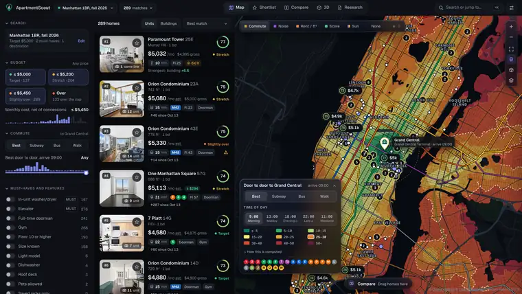
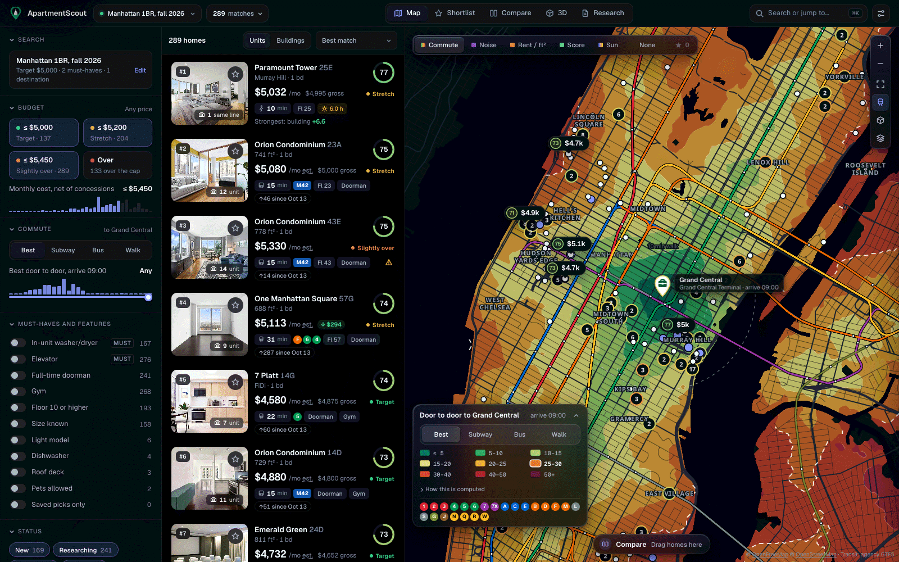
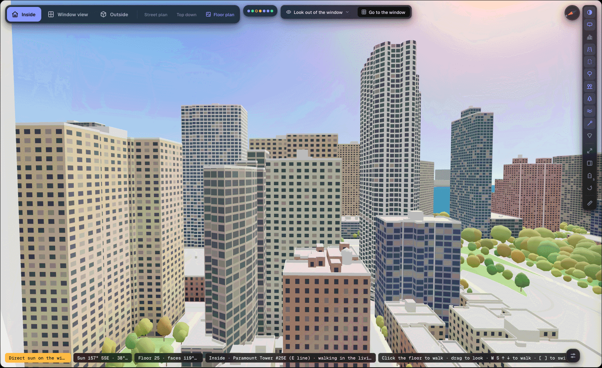
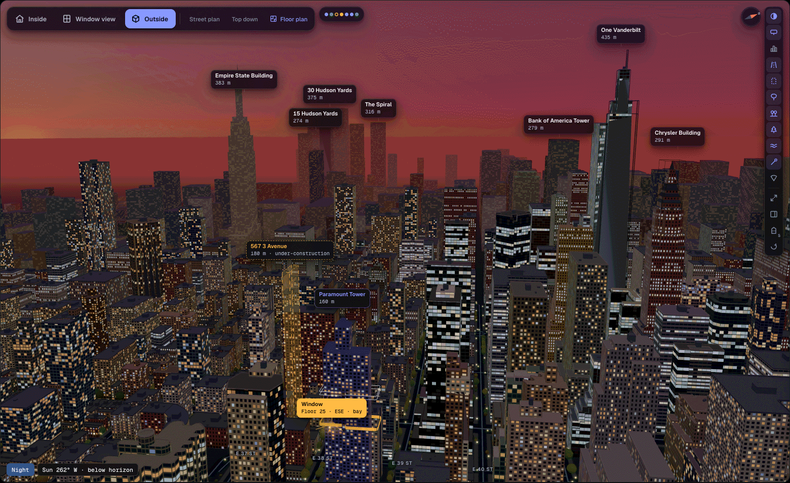
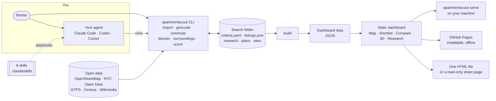

<h1 align="center">ApartmentScout</h1>

<p align="center"><b>Know the apartment before you sign.</b><br>
Rank every listing on your own criteria and its true monthly cost, time the commute, read the building's records, and stand
inside the exact unit, with your own furniture, in the real city around it.</p>

<p align="center">
<a href="https://github.com/0marm0/ApartmentScout/actions/workflows/tests.yml"></a>
<a href="https://github.com/0marm0/ApartmentScout/actions/workflows/pages.yml"></a>
<a href="LICENSE"></a>


</p>

<p align="center">
<a href="https://0marm0.github.io/ApartmentScout/demo/"></a>
<a href="docs/guides/iphone.md"></a>
<a href="#quick-start"></a>
</p>

<p align="center">
<a href="https://0marm0.github.io/ApartmentScout/demo/"></a><br>
<sub>Map, card, drawer, then inside the unit: walk to the window and watch the day turn to night. <a href="docs/images/walkthrough.mp4">Watch it in full quality (MP4)</a>.</sub>
</p>

<table>
<tr>
<td width="33%" valign="top" align="center"><a href="docs/images/find-commute-map.png"></a><br><sub><b>Every listing, ranked, on a door-to-door commute map</b></sub></td>
<td width="33%" valign="top" align="center"><a href="docs/images/inside-walk-window.png"></a><br><sub><b>Stand at the window of the exact unit</b></sub></td>
<td width="33%" valign="top" align="center"><a href="docs/images/inside-skyline-dusk.png"></a><br><sub><b>The real city around it, at any hour</b></sub></td>
</tr>
</table>

ApartmentScout came out of a real search for a one-bedroom in Manhattan: 738 listings in 260 buildings, and the same questions
for every finalist. What does it cost a month once fees and free months are counted? How long is the trip door to door? What do
the city's records say about the building? How loud is the street, and will the window see the sky or a wall? This repository
turns that process into agent playbooks, a Python command line and a dashboard you own, for any city, with that search included
as a worked example.

**Jump to:** [Find](#find) · [See inside](#see-inside) · [Sun and light](#sun-and-light) · [The city in 3D](#the-city-in-3d) · [Floor-plan studio](#floor-plan-studio) · [Compare](#compare) · [Decide](#decide) · [Set up](#set-up) · [On a phone](#on-a-phone). Every screen is from the worked example; click a picture for full size, and the [gallery](docs/GALLERY.md) has a caption for each.

## Find

Every listing ranked on your weights and its true monthly cost, on a door-to-door commute map; plain-words search, hover previews, and a reason for every rank. [More about each picture](docs/GALLERY.md#find).

<table>
<tr>
<td colspan="3" valign="top" align="center"><a href="docs/images/hero-map.png"></a><br><sub><b>The map, the ranked list and a home</b></sub></td>
</tr>
<tr>
<td width="33%" valign="top" align="center"><a href="docs/images/find-place-search.png"></a><br><sub><b>Ask in plain words</b></sub></td>
<td width="33%" valign="top" align="center"><a href="docs/images/find-building-pin.png"></a><br><sub><b>A building is one pin</b></sub></td>
<td width="33%" valign="top" align="center"><a href="docs/images/find-pin-preview.png"></a><br><sub><b>Hover a pin, see the home</b></sub></td>
</tr>
<tr>
<td width="33%" valign="top" align="center"><a href="docs/images/find-route-preview.png"></a><br><sub><b>Hover a card, see the trip</b></sub></td>
<td width="33%" valign="top" align="center"><a href="docs/images/find-rank-moves.png"></a><br><sub><b>Why a home moved</b></sub></td>
<td width="33%" valign="top" align="center"><a href="docs/images/find-unknowns.png"></a><br><sub><b>Unknowns that move this score</b></sub></td>
</tr>
<tr>
<td width="33%" valign="top" align="center"><a href="docs/images/find-price-audit.png"></a><br><sub><b>What it costs, and is the price real?</b></sub></td>
<td width="33%" valign="top" align="center"><a href="docs/images/find-price-drops.png"></a><br><sub><b>Real price history</b></sub></td>
<td width="33%" valign="top" align="center"><a href="docs/images/find-drawer-commute.png"></a><br><sub><b>Commute, sun and noise for one home</b></sub></td>
</tr>
<tr>
<td width="33%" valign="top" align="center"><a href="docs/images/find-lightbox.png"></a><br><sub><b>Photos and the floor plan</b></sub></td>
<td width="33%" valign="top" align="center"><a href="docs/images/find-map-clusters.png"></a><br><sub><b>A calmer map</b></sub></td>
<td width="33%" valign="top" align="center"><a href="docs/images/find-light-theme.png"></a><br><sub><b>The light theme</b></sub></td>
</tr>
</table>

## See inside

Unit 3D puts you in the exact unit with the furniture you own and the real city through the glass: walk to the window, measure, test what fits. [More about each picture](docs/GALLERY.md#see-inside).

<table>
<tr>
<td colspan="3" valign="top" align="center"><a href="docs/images/inside-unit-3d.png"></a><br><sub><b>Unit 3D lands inside the apartment</b></sub></td>
</tr>
<tr>
<td width="33%" valign="top" align="center"><a href="docs/images/inside-furniture.png"></a><br><sub><b>Your own furniture</b></sub></td>
<td width="33%" valign="top" align="center"><a href="docs/images/inside-bay.png"></a><br><sub><b>Through the angled windows</b></sub></td>
<td width="33%" valign="top" align="center"><a href="docs/images/inside-bedroom.png"></a><br><sub><b>The bedroom</b></sub></td>
</tr>
<tr>
<td width="33%" valign="top" align="center"><a href="docs/images/inside-night-window.png"></a><br><sub><b>The night city</b></sub></td>
<td width="33%" valign="top" align="center"><a href="docs/images/inside-measure-tape.png"></a><br><sub><b>The measuring tape</b></sub></td>
<td width="33%" valign="top" align="center"><a href="docs/images/inside-fits.png"></a><br><sub><b>Does it fit?</b></sub></td>
</tr>
<tr>
<td width="50%" valign="top" align="center"><a href="docs/images/inside-match-photo.png"></a><br><sub><b>Match a photo</b></sub></td>
<td width="50%" valign="top" align="center"><a href="docs/images/inside-measured-chip.png"></a><br><sub><b>Measured, sourced or assumed</b></sub></td>
</tr>
</table>

## Sun and light

When the sun reaches the window, on which floor and in which season, and what stands in its way, from real building footprints and heights. [More about each picture](docs/GALLERY.md#sun-and-light).

<table>
<tr>
<td width="50%" valign="top" align="center"><a href="docs/images/sun-low-floor.png"></a><br><sub><b>Floor 8: in shadow</b></sub></td>
<td width="50%" valign="top" align="center"><a href="docs/images/sun-high-floor.png"></a><br><sub><b>Floor 25, same moment: direct sun</b></sub></td>
</tr>
<tr>
<td width="50%" valign="top" align="center"><a href="docs/images/sun-winter-shadows.png"></a><br><sub><b>December 21, noon</b></sub></td>
<td width="50%" valign="top" align="center"><a href="docs/images/sun-summer-shadows.png"></a><br><sub><b>June 21, noon</b></sub></td>
</tr>
<tr>
<td width="50%" valign="top" align="center"><a href="docs/images/sun-path-chart.png"></a><br><sub><b>Sun path against the skyline</b></sub></td>
<td width="50%" valign="top" align="center"><a href="docs/images/inside-sun-by-floor.png"></a><br><sub><b>Sun by floor and month</b></sub></td>
</tr>
<tr>
<td width="50%" valign="top" align="center"><a href="docs/images/sun-plan-view.png"></a><br><sub><b>From above: what stands in the way</b></sub></td>
<td width="50%" valign="top" align="center"><a href="docs/images/inside-play-year.png"></a><br><sub><b>Play the day, play the year</b></sub></td>
</tr>
<tr>
<td width="50%" valign="top" align="center"><a href="docs/images/inside-orbit-day.png"></a><br><sub><b>By day</b></sub></td>
<td width="50%" valign="top" align="center"><a href="docs/images/inside-orbit-night.png"></a><br><sub><b>And at night</b></sub></td>
</tr>
</table>

## The city in 3D

Every building around the home with its height, the skyline, the water, the parks and the towers still to come. [More about each picture](docs/GALLERY.md#the-city-in-3d).

<table>
<tr>
<td colspan="3" valign="top" align="center"><a href="docs/images/city-building-models.png"></a><br><sub><b>Every building around the tower, with its height</b></sub></td>
</tr>
<tr>
<td width="50%" valign="top" align="center"><a href="docs/images/city-map-3d.png"></a><br><sub><b>The map in 3D</b></sub></td>
<td width="50%" valign="top" align="center"><a href="docs/images/inside-river.png"></a><br><sub><b>Water and permitted towers</b></sub></td>
</tr>
<tr>
<td width="50%" valign="top" align="center"><a href="docs/images/inside-park-trees.png"></a><br><sub><b>Parks and trees</b></sub></td>
<td width="50%" valign="top" align="center"><a href="docs/images/inside-light-theme.png"></a><br><sub><b>The light theme</b></sub></td>
</tr>
</table>

## Floor-plan studio

The plan in 2D and 3D side by side: furniture at real sizes, clearances, sunlight on the floor, and new plans traced from a listing image. [More about each picture](docs/GALLERY.md#floor-plan-studio).

<table>
<tr>
<td width="50%" valign="top" align="center"><a href="docs/images/inside-floor-plan.png"></a><br><sub><b>Bird's eye beside the plan</b></sub></td>
<td width="50%" valign="top" align="center"><a href="docs/images/studio-top.png"></a><br><sub><b>Top down, with every dimension</b></sub></td>
</tr>
<tr>
<td width="50%" valign="top" align="center"><a href="docs/images/studio-light.png"></a><br><sub><b>The light tab</b></sub></td>
<td width="50%" valign="top" align="center"><a href="docs/images/studio-tracer.png"></a><br><sub><b>Trace a plan from an image</b></sub></td>
</tr>
</table>

## Compare

Finalists row by row, two units side by side in 3D, and a pad to trade cost against commute and space. [More about each picture](docs/GALLERY.md#compare).

<table>
<tr>
<td width="50%" valign="top" align="center"><a href="docs/images/compare-four.png"></a><br><sub><b>Four finalists, row by row</b></sub></td>
<td width="50%" valign="top" align="center"><a href="docs/images/compare-side-by-side-3d.png"></a><br><sub><b>Two units side by side in 3D</b></sub></td>
</tr>
<tr>
<td width="50%" valign="top" align="center"><a href="docs/images/compare-tradeoff-pad.png"></a><br><sub><b>The trade-off pad</b></sub></td>
<td width="50%" valign="top" align="center"><a href="docs/images/compare-split-view.png"></a><br><sub><b>The shortlist beside its map</b></sub></td>
</tr>
</table>

## Decide

Building records, questions for the leasing office, visit notes, tours, a share page and a decision memo. [More about each picture](docs/GALLERY.md#decide).

<table>
<tr>
<td width="33%" valign="top" align="center"><a href="docs/images/decide-records.png"></a><br><sub><b>Building records</b></sub></td>
<td width="33%" valign="top" align="center"><a href="docs/images/decide-office-questions.png"></a><br><sub><b>Questions for the leasing office</b></sub></td>
<td width="33%" valign="top" align="center"><a href="docs/images/decide-visit-history.png"></a><br><sub><b>Visit notes and history</b></sub></td>
</tr>
<tr>
<td width="33%" valign="top" align="center"><a href="docs/images/decide-tours-board.png"></a><br><sub><b>The tours board</b></sub></td>
<td width="33%" valign="top" align="center"><a href="docs/images/decide-tour-planner.png"></a><br><sub><b>The tour-day planner</b></sub></td>
<td width="33%" valign="top" align="center"><a href="docs/images/decide-memo.png"></a><br><sub><b>The decision memo</b></sub></td>
</tr>
<tr>
<td width="33%" valign="top" align="center"><a href="docs/images/decide-share-page.png"></a><br><sub><b>A page to send</b></sub></td>
<td width="33%" valign="top" align="center"><a href="docs/images/decide-research-queue.png"></a><br><sub><b>What you still don't know</b></sub></td>
<td width="33%" valign="top" align="center"><a href="docs/images/decide-gone-fast.png"></a><br><sub><b>What rented, and how fast</b></sub></td>
</tr>
</table>

## Set up

Any city: a wizard in the dashboard, an interview in the terminal, or your agent. [More about each picture](docs/GALLERY.md#set-up).

<table>
<tr>
<td width="50%" valign="top" align="center"><a href="docs/images/setup-wizard-city.png"></a><br><sub><b>The new search wizard</b></sub></td>
<td width="50%" valign="top" align="center"><a href="docs/images/setup-wizard-review.png"></a><br><sub><b>Review the criteria.yaml</b></sub></td>
</tr>
<tr>
<td width="50%" valign="top" align="center"><a href="docs/images/setup-menu.png"></a><br><sub><b>One menu</b></sub></td>
<td width="50%" valign="top" align="center"><a href="docs/images/setup-cli.png"></a><br><sub><b>The command line</b></sub></td>
</tr>
</table>

## On a phone

Installs as an app: the map, a listing, Unit 3D, visit notes and a one-hand tour day. [More about each picture](docs/GALLERY.md#on-a-phone).

<table>
<tr>
<td width="16%" valign="top" align="center"><a href="docs/images/phone-map.png"></a><br><sub><b>Map and cards</b></sub></td>
<td width="16%" valign="top" align="center"><a href="docs/images/phone-drawer.png"></a><br><sub><b>A listing</b></sub></td>
<td width="16%" valign="top" align="center"><a href="docs/images/phone-unit-3d.png"></a><br><sub><b>Unit 3D</b></sub></td>
<td width="16%" valign="top" align="center"><a href="docs/images/phone-visit-notes.png"></a><br><sub><b>Visit notes</b></sub></td>
<td width="16%" valign="top" align="center"><a href="docs/images/phone-tour-day.png"></a><br><sub><b>Tour day</b></sub></td>
<td width="16%" valign="top" align="center"><a href="docs/images/phone-tour-checklist.png"></a><br><sub><b>The checklist</b></sub></td>
</tr>
</table>

## Quick start

**Look first.** The [live demo](https://0marm0.github.io/ApartmentScout/demo/) is the dashboard on the worked example, running in
your browser: 738 Manhattan listings (434 active) in 260 buildings, commutes to an office near Grand Central, 16 3D site models,
9 floor plans and 30 building dossiers. Or run it on your own machine:

```bash
git clone --depth 1 https://github.com/0marm0/ApartmentScout.git   # --depth 1: today's files, not the whole history
cd ApartmentScout
python -m venv .venv && source .venv/bin/activate
pip install -e .                                       # ".[xlsx]" adds the workbook export, ".[dev]" the test tools
apartmentscout serve --search examples/nyc-2026
```

**Then your own search**, from nothing to a ranked map in about 15 minutes, in any city
([the full walk-through](docs/guides/getting-started.md)). It asks for your **city** (looked up, so the time zone and map are
right), your **places** (addresses are found and confirmed) and your **transit timetable** (a starter feed is offered where one has
been checked):

<!-- quickstart -->
```bash
apartmentscout init searches/my-search --city "Chicago, IL" --interactive
export APARTMENTSCOUT_SEARCH=searches/my-search
apartmentscout import searches/my-search/listings.csv   # fill the listings.template.csv that init wrote, or ask your agent
apartmentscout validate && apartmentscout lint         # catch bad data and listing traps early
apartmentscout all                                     # geocode, commute by mode, layers, places, score, build
apartmentscout surroundings                            # fetch the buildings around each shortlisted home (3D, sun, view)
apartmentscout plans                                   # floor plans: which homes have one, and how to add one
apartmentscout serve                                   # open the dashboard on your own data
```

Prefer to click? Run `apartmentscout serve`, open the menu at the top right and choose *New search*: a wizard asks the same
questions and writes the same `criteria.yaml`. Prefer to talk? Open the repository in Claude Code, Codex or Cursor and say
"help me find a one-bedroom near X under $Y": the agent reads [`AGENTS.md`](AGENTS.md) and interviews you. Requires Python 3.10+.
Floor plans: [adding your floor plans](docs/guides/getting-started.md#7-adding-your-floor-plans).

## How it works

Three parts, all yours, all plain files in a folder. No account, server or API key sits between you and your data.



| | What it does |
|---|---|
| **Your agent** | Open the repository in Claude Code, Codex, Cursor or any agent that reads [`AGENTS.md`](AGENTS.md). Nine [skills](.claude/skills) walk it through intake, listing sourcing, commutes, building dossiers, noise, light and view, floor plans, lease and fees, and tours. It checks its own data with `validate`, `lint` and `coverage`, and drafts messages to leasing offices without sending them. |
| **The CLI** | Every stage is one command over files in your search folder: `geocode`, `commute`, `dossier`, `surroundings`, `score`, `build`, `export`, `share`. Repeatable, scriptable, and offline once the data is pulled. |
| **The dashboard** | Map, Shortlist, Compare, 3D and Research in one static page with one menu. Serve it, host it on GitHub Pages, open it as a single HTML file, or install it as an app. |

The [methodology](docs/guides/methodology.md) covers the money model, the scoring formula, the commute router and its validation,
and the sun and skyline model, and says what each one leaves out.

## On your phone

The dashboard is an installable app. On an iPhone, open the demo in Safari, tap Share, then **Add to Home Screen**: it opens
full screen and keeps working with no signal. On tour day it gives you today's visits in order with directions, a checklist at each
home and a noise check. The steps, what works offline and what stays on the phone are in the
[iPhone guide](docs/guides/iphone.md).

## Privacy

- **Your search stays yours.** Searches live in `searches/`, which git ignores. Your criteria, notes, saved picks, visit answers and
  tour-day checklist stay on your machine, and in the browser's own storage on your phone. There is no account, no analytics and no
  ApartmentScout server.
- **What the network sees.** Building a search reads public sources (OpenStreetMap, NYC Open Data, the US Census geocoder,
  transit agencies' feeds, Wikimedia Commons). The dashboard's map loads tiles from OpenFreeMap and Esri imagery, like any web map.
  The landing page loads nothing from other sites.
- **The example data.** [`examples/nyc-2026`](examples/nyc-2026) is a real Manhattan one-bedroom search, lightly anonymised: public
  listings, public records and open data. It contains no renter identity, income or documents. The saved picks and visit notes in the
  gallery are sample entries. Listing photos belong to their owners; Commons building photos carry their licence and author.
- **Sites' rules are respected.** Agents are told to use official APIs and open data, never to bypass a CAPTCHA or bot check, never
  to log in, and never to contact a landlord without your say-so. When a portal blocks automated reading, the agent stops and asks
  you to open the page yourself.
- **Sync is off until you turn it on.** It then sends your picks, notes, numbers, tour findings, floor plan work and (optionally)
  small copies of tour photos to **a secret gist in your own GitHub account** (unlisted, so anyone with its link can read it) or
  to a file you move by hand, and nowhere else: no server of ours, no telemetry. The GitHub token stays in the browser on the
  device and is sent only to `api.github.com`. See [the sync guide](docs/guides/sync.md).
- **Reports are not findings.** 311 calls, complaints and reviews are shown as reports. Commute, sun, money and score numbers are
  estimates, and coverage is of the listings you captured, not a market census. Check the important ones in person.
- **Publishing.** A Pages site, a standalone file or a workbook shows your listings and notes to whoever has it. Run
  `python scripts/release_check.py` first.

## FAQ

<details>
<summary><b>Does it work outside New York?</b></summary>

Yes. Any city OpenStreetMap knows gets the map, geocoding, walking times, 3D site models, sun and view, floor plans and ranking;
add a transit timetable (GTFS) for commutes by subway and bus. Building-records automation and the noise layer are New York only
for now. Elsewhere an agent researches records with the `building-dossier` skill. `apartmentscout city "Your City"` shows what your
city has, and [adding a city profile](docs/guides/new-city.md) is a short YAML file. You can also
[request or offer a city](https://github.com/0marm0/ApartmentScout/issues/new?template=new_city.yml).
</details>

<details>
<summary><b>Where does the data come from, and under what licences?</b></summary>

NYC Open Data, the US Census geocoder, OpenStreetMap (ODbL), MTA and other agencies' GTFS feeds, Esri imagery and Wikimedia
Commons photos, with MapLibre GL, three.js, d3-contour and the Geist fonts. Each keeps its own licence and attribution; they are
summarised in [THIRD_PARTY_NOTICES.md](THIRD_PARTY_NOTICES.md). Keep the map attribution visible on anything you publish and show the
credit line with every Commons photo. Listings are what you or your agent capture, within each source's terms.
</details>

<details>
<summary><b>Do I need an AI agent, an API key or an account?</b></summary>

No. Everything built in uses free public data and needs no key. You can run the CLI and the dashboard by hand, or use the wizard.
An agent (Claude Code, Codex, Cursor, anything that reads `AGENTS.md`) is optional: it does the sourcing and research legwork.
</details>

<details>
<summary><b>Does it work offline?</b></summary>

Once your data is built, yes: the CLI works on local files, and the hosted dashboard installs as an app that keeps its shell, data
and the 3D models you have opened in the browser's cache. Map tiles and photos you have not opened need a connection. A single-file
build (`apartmentscout build --standalone`) opens with no server at all. Details:
[the dashboard guide](docs/guides/dashboard.md#install-it-and-use-it-offline).
</details>

<details>
<summary><b>Does it work on a phone?</b></summary>

Yes. The layout follows the screen, Unit 3D has a phone layout, and Tour day is built for one hand. Add it to your Home Screen to
use it offline: see the [iPhone guide](docs/guides/iphone.md) (Android: Chrome's *Install app* in the dashboard's Help menu).
</details>

<details>
<summary><b>Can it contact landlords or apply for me?</b></summary>

No. It drafts questions and emails for you to copy; nothing is sent from the page or by an agent unless you explicitly ask it to.
</details>

<details>
<summary><b>How accurate are the sun, view and commute numbers?</b></summary>

They are models, and the [methodology](docs/guides/methodology.md) says what each one leaves out (trees are context and never count
as shade; heights default where OpenStreetMap has none; a commute is a timetable estimate, not a live route). Unknowns stay
unknown and are listed so you know what to ask or check on a visit.
</details>

## Documentation

| | |
|---|---|
| Start | [Getting started](docs/guides/getting-started.md) · [The dashboard](docs/guides/dashboard.md) · [iPhone guide](docs/guides/iphone.md) · [Sync between devices](docs/guides/sync.md) · [Other cities](docs/guides/new-city.md) |
| How it is computed | [Methodology](docs/guides/methodology.md) · [Data model](docs/guides/data-model.md) · [Research quality](docs/guides/research-quality.md) · [Leasing-office questions](docs/guides/leasing-office-questions.md) |
| 3D and photos | [Floor plans](docs/guides/floor-plans.md) · [Photos](docs/guides/photos.md) · [Gallery](docs/GALLERY.md) |
| Agents | [AGENTS.md](AGENTS.md) · [Skills](.claude/skills) · [Agent handoff](docs/guides/agents-handoff.md) · [Monitoring](docs/guides/monitoring.md) · [Alerts on your phone](docs/guides/alerts.md) |
| Project | [Roadmap](docs/ROADMAP.md) · [Release checklist](docs/RELEASE_CHECKLIST.md) · [Design system](docs/design/design-system.md) · [Third-party notices](THIRD_PARTY_NOTICES.md) |

The worked example, [`examples/nyc-2026`](examples/nyc-2026), has 738 listings, commutes on the MTA timetables, a 311 noise layer,
30 building dossiers, 16 3D site models and 9 floor plans. Its photos are in two sets (a 34 MB starter set in the repository, the
full set on demand): see [photos](docs/guides/photos.md). The site, with the demo at `/demo/`, is published by
`.github/workflows/pages.yml` on every push to `main`.

## Contributing

Issues and pull requests are welcome, especially city profiles, records modules, GTFS feed lists and better floor-plan tooling.
Start with [CONTRIBUTING.md](CONTRIBUTING.md) (set-up and tests), use the [issue forms](https://github.com/0marm0/ApartmentScout/issues/new/choose)
for a bug, a feature or a new city, and follow the [code of conduct](CODE_OF_CONDUCT.md). Before you open a pull request:

```bash
pip install -e ".[dev]"
python scripts/test_changed.py         # runs the unit, JavaScript and browser tests your change touches
```

To report a security problem privately, see [SECURITY.md](SECURITY.md). If you use the project in research, [CITATION.cff](CITATION.cff)
has a citation.

## Licence

MIT, see [LICENSE](LICENSE). Data from the sources above remains under its own terms; see [THIRD_PARTY_NOTICES.md](THIRD_PARTY_NOTICES.md).
