# Gallery

Screenshots of the ApartmentScout dashboard on the included example (a Manhattan one-bedroom search from
fall 2026 with a commute to a Midtown office near Grand Central), followed by the earlier one-off tools
built during that search, which the dashboard grew out of. Listing photos and videos are never shown.

Every image here is marked `public` in [`gallery/manifest.json`](gallery/manifest.json); see
[THIRD_PARTY_NOTICES.md](../THIRD_PARTY_NOTICES.md) for map and photo attribution.

## The ApartmentScout dashboard

### Map

The home view: a filter rail with budget tiers, histograms, must-haves and live weight sliders; ranked
listing cards with walk, subway and bus minutes; and a vector map with heat layers, official subway
lines, price tags and a floating listing drawer.

<table>
<tr><td width="50%">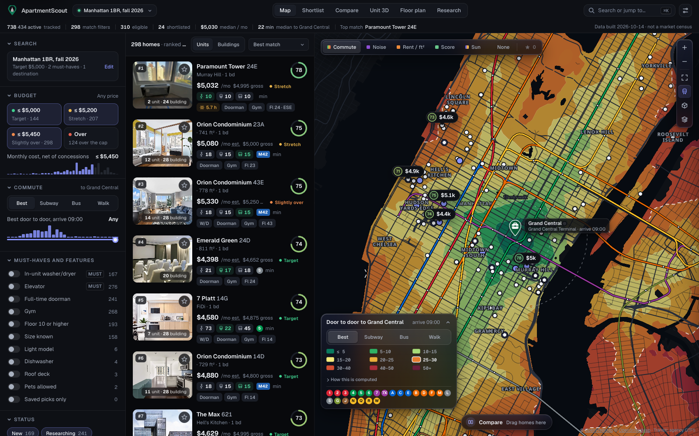 Best-of-transit door-to-door minutes, arriving 09:00: green inside the 30-minute limit, red past it, the limit dashed</td><td width="50%">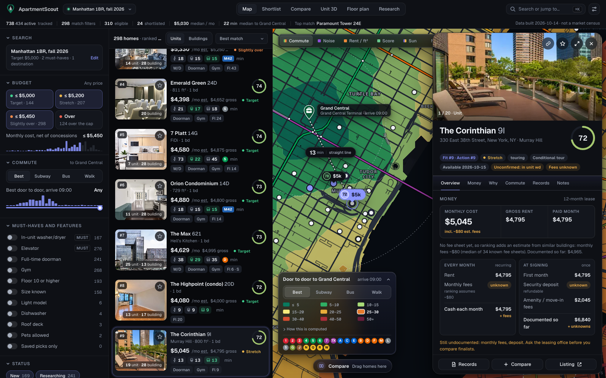 Listing drawer: a credited building photo, monthly cost, gross rent and paid month, move-in cash, unknown fees left unknown, tier headroom and why it ranks here</td></tr>
<tr><td width="50%">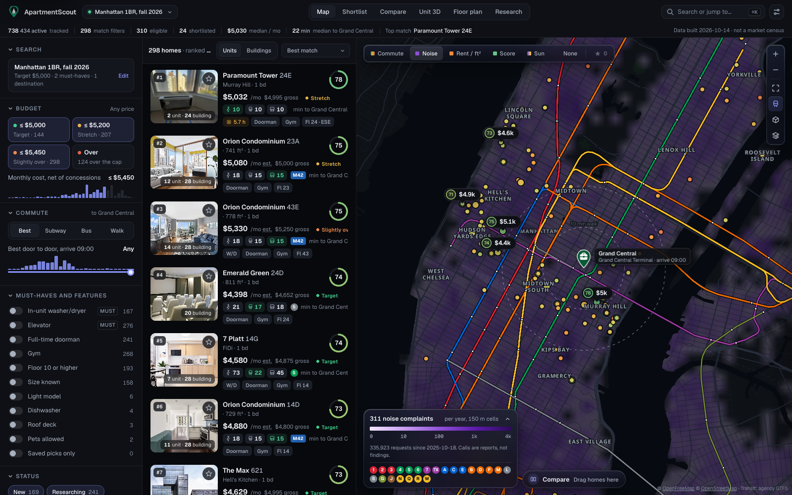 311 noise complaints per year in 150 m cells (335,923 requests), labelled as reports, not findings</td><td width="50%">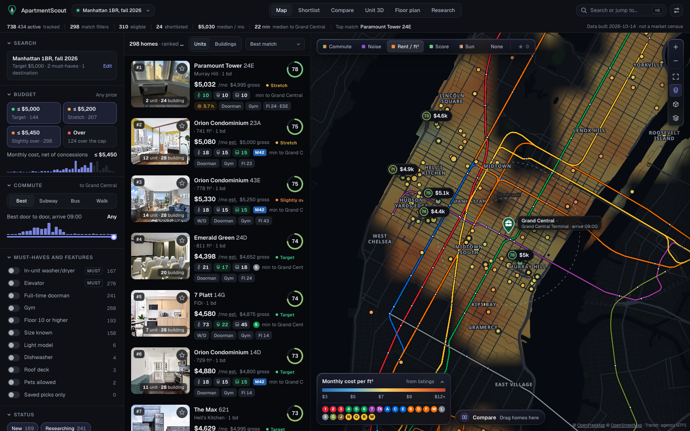 Monthly cost per ft², interpolated from the listings</td></tr>
<tr><td width="50%">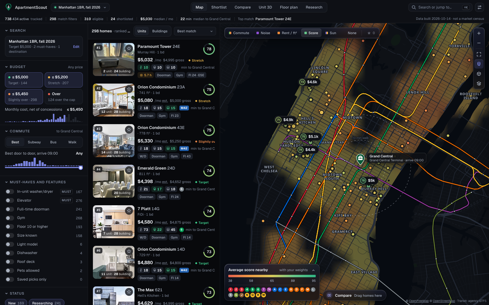 Average score nearby with your weights</td><td width="50%">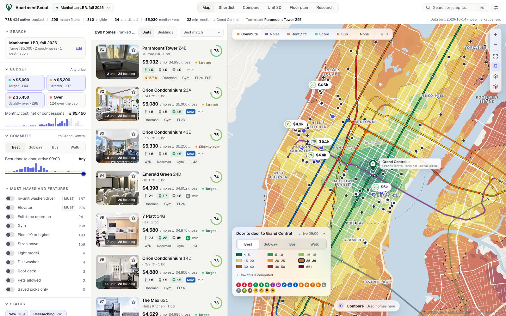 The light theme</td></tr>
<tr><td width="50%"> 3D buildings over the commute bands, with subway lines, stations and walking-time rings</td><td width="50%"> Commute by mode: best, subway, bus and walk tiles, the route leg by leg with times, records flags, what residents say and open questions</td></tr>
<tr><td width="50%" align="center">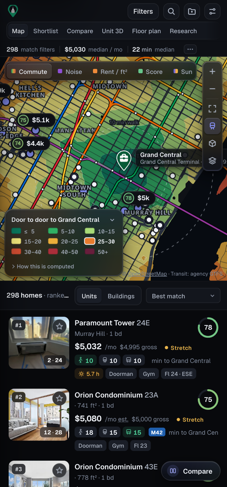 On a phone: the map on top, ranked cards in a sheet below</td><td></td></tr>
</table>

### Shortlist

<table>
<tr><td>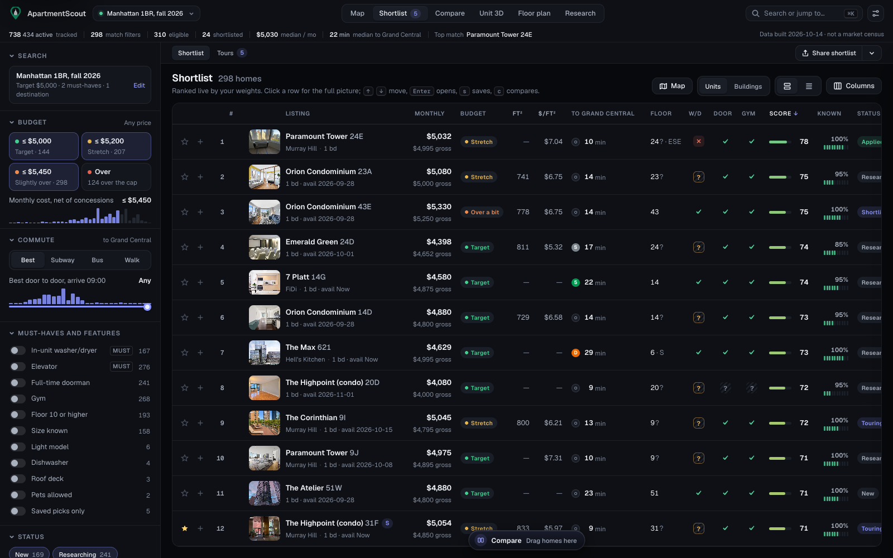 Every filtered listing ranked live by your weights: monthly cost, budget tier, size and $/ft², commute, floor and exposure, laundry, doorman and gym (? means unconfirmed), score, the share of the score resting on known facts, and status. Keyboard: arrows move, Enter opens, s saves, c compares.</td></tr>
</table>

### Compare

<table>
<tr><td> Four finalists in lettered columns: money, space, commute, building, light and score rows with the best value in each row marked and unknowns that never count as the worst; hard requirements and open questions; a cost-against-space scatter of every eligible listing with the value frontier; and where each one wins, dimension by dimension.</td></tr>
</table>

### Unit 3D

The building and its real neighbours in 3D, with sun, shadows, the view from the window and from inside
the apartment.

<table>
<tr><td colspan="2">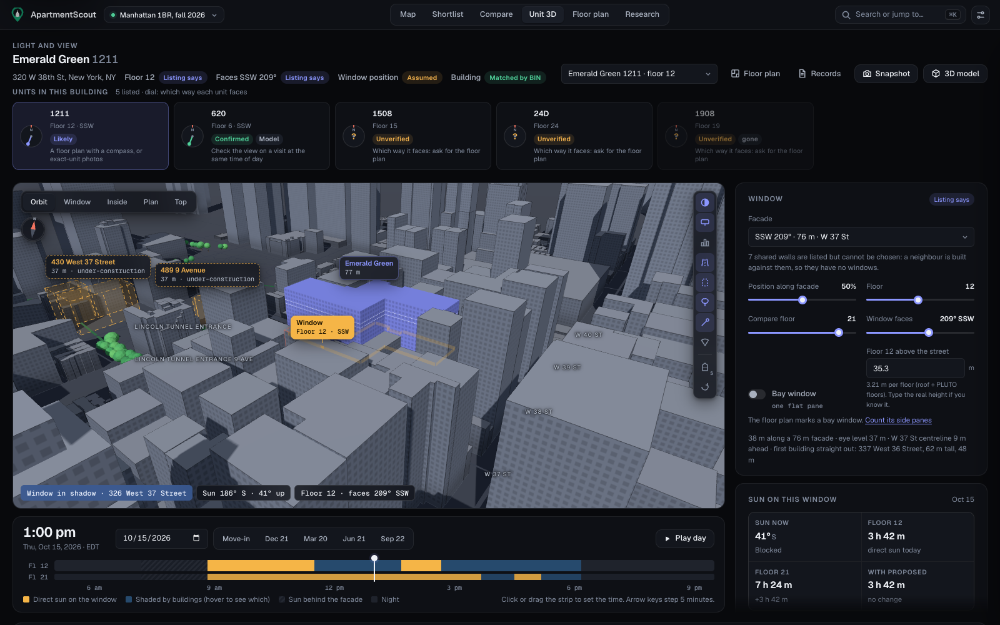 Emerald Green 1211: provenance chips (listing says, assumed, matched by BIN), units in the building with compass dials, Orbit / Window / Inside / Plan / Top cameras, towers under construction drawn dashed, the window panel and a day strip comparing floors 12 and 21 on October 15</td></tr>
<tr><td width="50%"> From the 12th-floor window at 1 pm: in the shadow of 326 West 37th Street</td><td width="50%"> Same line, 21st floor: direct sun, One Manhattan West, and a permitted tower outlined where it will stand</td></tr>
<tr><td width="50%">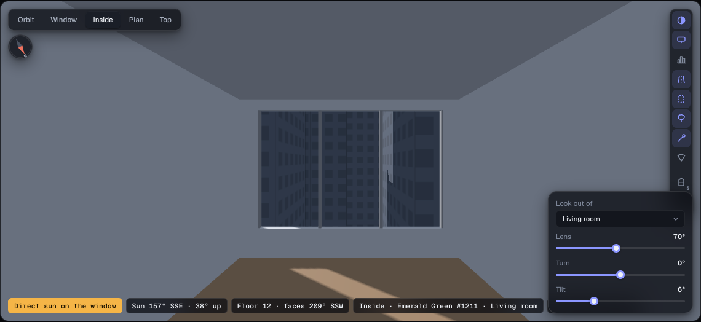 Inside: the floor plan's walls and windows at the real slab height, with the sun patch on the floor at 11:30 am</td><td width="50%"> North-up plan camera with the window and the filed new buildings around it</td></tr>
<tr><td width="50%">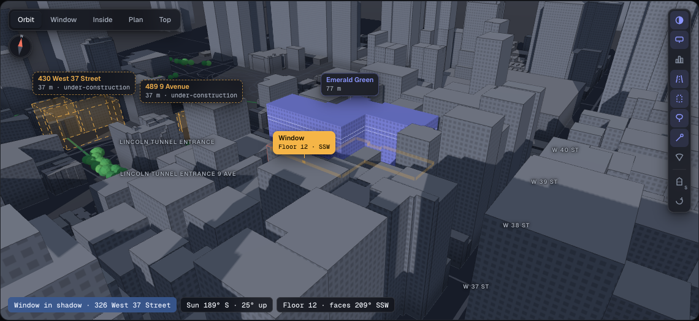 December 21 at 12:30 pm: long winter shadows</td><td width="50%"> Another building, 22nd floor, 7:30 pm on June 21: Hudson Yards with proposed and rising towers outlined</td></tr>
<tr><td width="50%">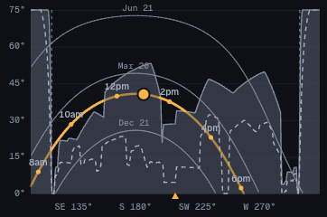 Sun paths against the skyline from the window; dashed, the skyline from the compare floor</td><td width="50%">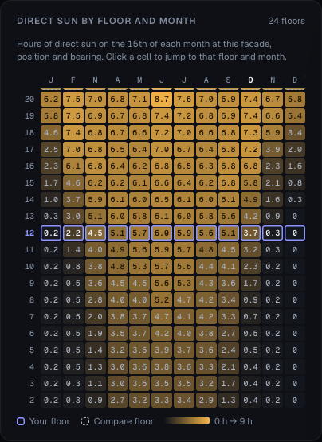 Direct-sun hours on the 15th of each month for every floor; your floor outlined</td></tr>
<tr><td width="50%">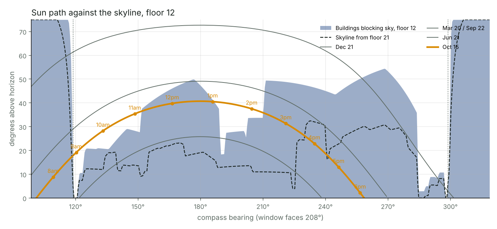 Report chart from <code>apartmentscout site --charts</code>: sun path, floor 12</td><td width="50%">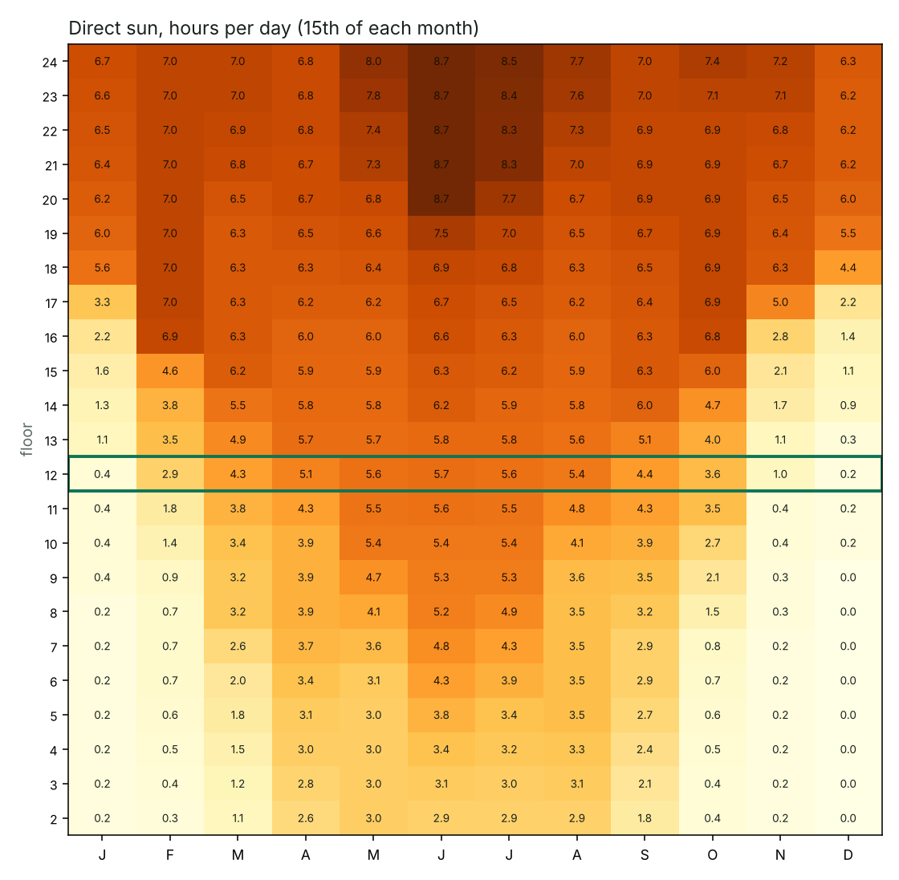 Report chart: direct sun by floor and month</td></tr>
</table>

### Floor plan

<table>
<tr><td width="68%"> Synced 2D plan and 3D model under the real sun: ten pieces placed with fit checks all clear, bed and sofa TV distances marked ideal, eye-level cameras and two layout presets written for this plan</td><td width="32%">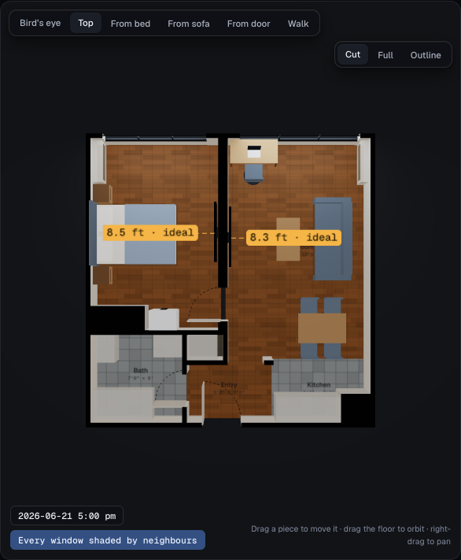 Top-down at 5 pm on June 21; every window shaded by neighbours</td></tr>
</table>

### Records

<table>
<tr><td> A due-diligence report for one building: PLUTO facts, record and street-noise scores, metric tiles, a "What matters" table (issue, evidence, practical significance), monthly timelines of 311 and official records, 311 by hour and type, complaints and crime by category, collapsible ledgers, research notes and sources.</td></tr>
</table>

### Research

<table>
<tr><td width="50%"> The finalist standard and its gaps, then the research queue: missing and stale facts, points at stake, last check and copyable questions</td><td width="50%">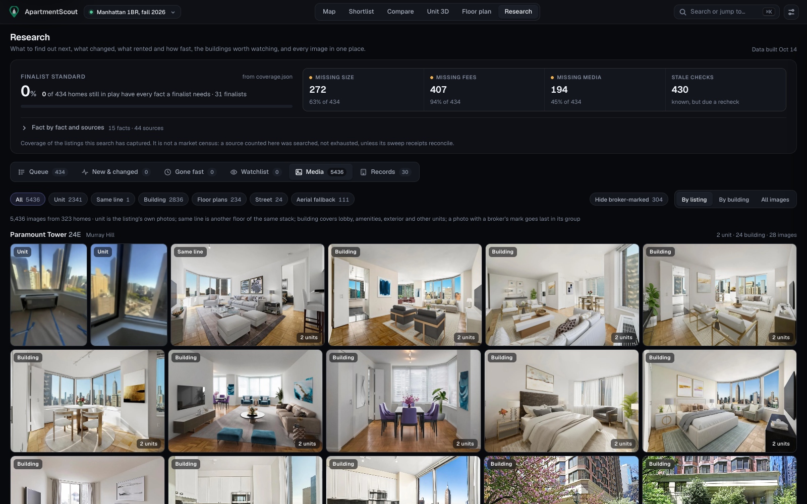 Media: licensed building photos with author and licence, plans and aerial fallbacks, filtered by scope</td></tr>
</table>

### Tours

<table>
<tr><td>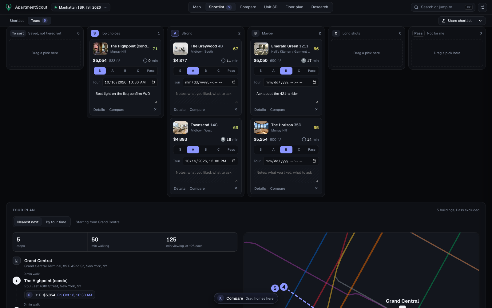 Saved picks on a tier board (S, A, B, C, Pass) with tour times and notes, a backup file, and a tour plan in nearest-next order from the office with walking and viewing minutes.</td></tr>
</table>

### The CLI

<table>
<tr><td> <code>commute</code>, <code>site</code> and <code>score</code> on the example search</td></tr>
</table>

### More screens

<table>
<tr><td width="50%">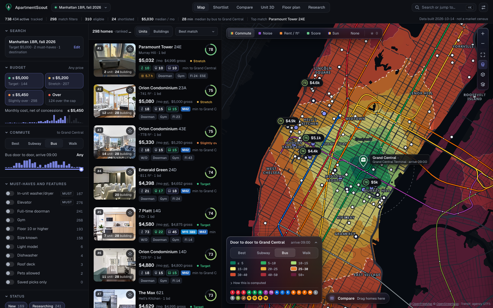 Commute lens: bus</td><td width="50%"> Commute lens: walk rings</td></tr>
<tr><td>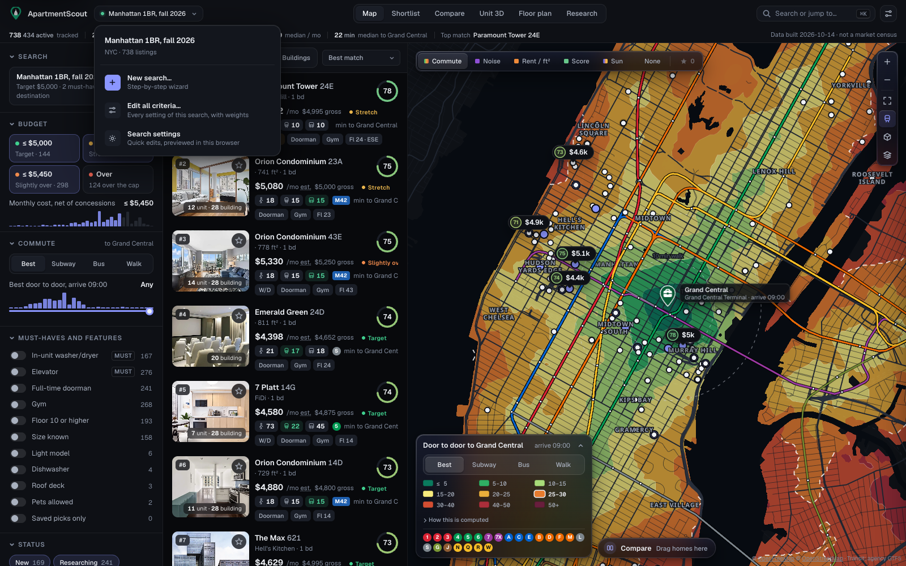 Search settings</td><td> Money: every month, at signing, over the lease</td></tr>
<tr><td>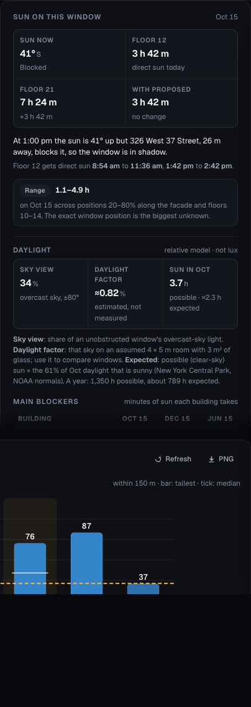 Daylight and blockers</td><td> Unit 3D, light theme</td></tr>
<tr><td>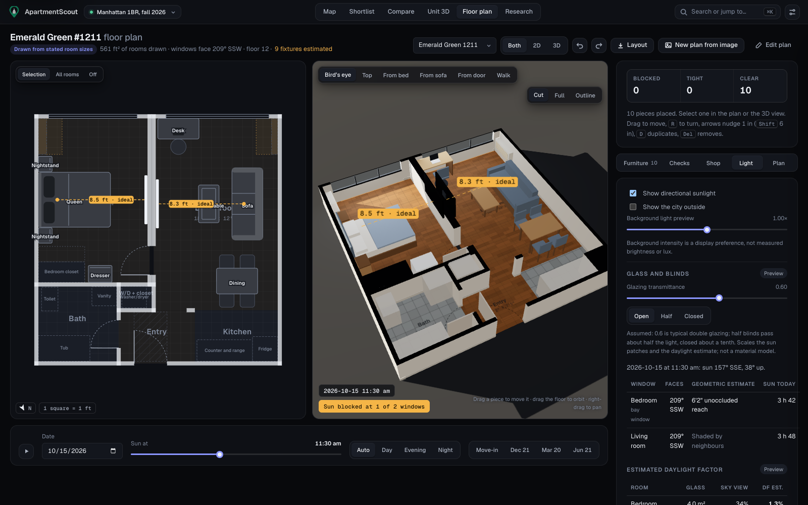 Floor plan light tab</td><td>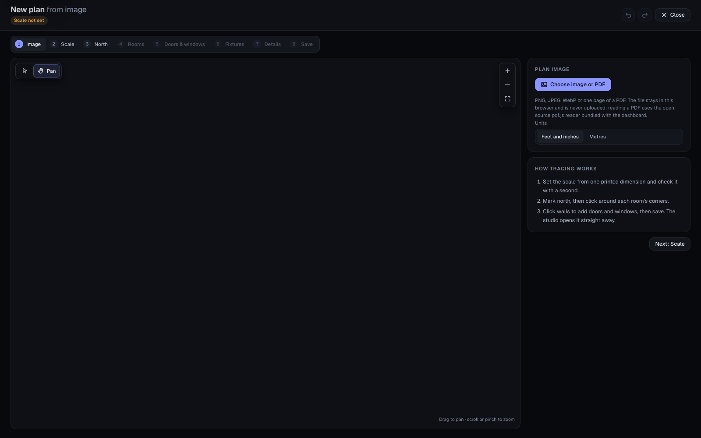 Plan tracer</td></tr>
<tr><td> Compare, light theme</td><td>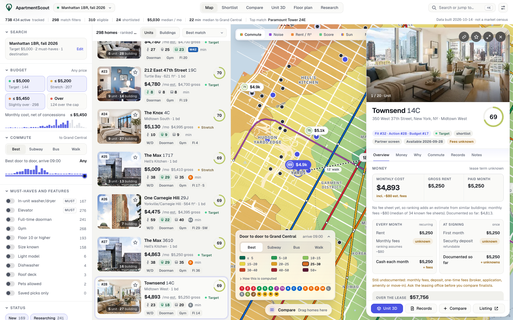 Map, light theme</td></tr>
<tr><td>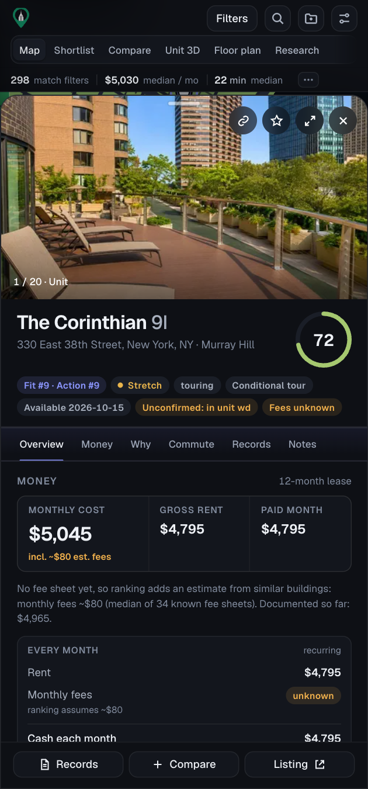 Phone: listing panel</td><td>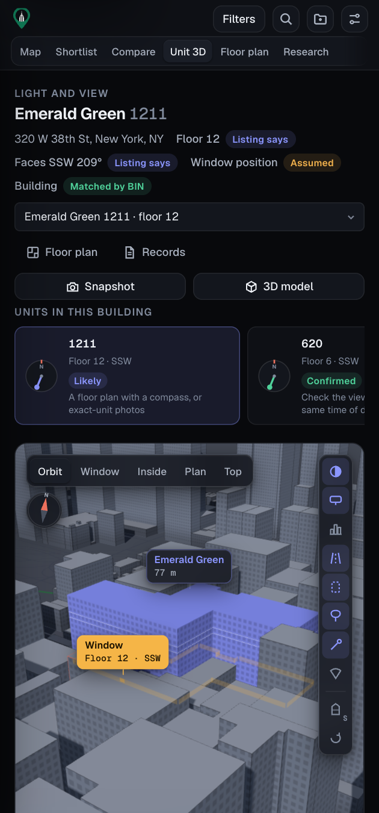 Phone: Unit 3D</td></tr>
</table>

## Earlier tools from the search

The one-off tools an agent built during the Manhattan search, kept as design references and as examples
of what an agent can produce with this workflow. *Each was a prototype built by an agent during the
search.*

### First search dashboard

Every unit inside the commute radius on a styled Manhattan map with subway lines, filters, budget tiers,
weights, watchlist, gone-fast, compare and tour plan. Light and dark.

<table>
<tr><td width="50%"> Dark mode, ranked by nicest and biggest</td><td width="50%"> Light mode home</td></tr>
<tr><td width="50%"> All units table</td><td width="50%"> New and changed listings</td></tr>
<tr><td width="50%"> Gone fast: what rented and how quickly</td><td width="50%"> My list</td></tr>
<tr><td width="50%"> Compare</td><td width="50%"> Compare, dark</td></tr>
<tr><td width="50%"> Tour plan</td><td width="50%"> Tour plan, dark</td></tr>
<tr><td width="50%"> Playbook</td><td></td></tr>
</table>

### Codex research site

A multi-page research site: unit sheet, building rankings, space research, shortlist and tours, personal
picks and dated research reports.

<table>
<tr><td width="50%"> Find the biggest, nicest options</td><td width="50%"> Every unit on one sheet</td></tr>
<tr><td width="50%"> Every researched building</td><td width="50%"> Shortlist and tours</td></tr>
<tr><td width="50%"> My picks</td><td width="50%"> Research report, Sep 28</td></tr>
</table>

### First commute heat map

The first commute heat map to a Midtown office near Grand Central.

<table>
<tr><td width="50%"> Commute heat map</td><td></td></tr>
</table>

### Emerald Green 1211 light and view model

Real NYC footprints and roof heights, live sun for any date and time, the view from the window, sun path
against the skyline, landmark visibility and direct sun by floor and month. The Unit 3D view generalises it
to any listing with a site model.

<table>
<tr><td width="50%"> Oct 15, 1 pm: orbit view with the sun ray</td><td width="50%"> From the 12th-floor window</td></tr>
<tr><td width="50%"> From the 21st floor, same line</td><td width="50%"> December 21 at noon</td></tr>
<tr><td width="50%"> Sun paths against the skyline</td><td width="50%"> Direct sun hours by floor and month</td></tr>
<tr><td width="50%"> The whole model page</td><td width="50%"> Dark mode</td></tr>
<tr><td width="50%"> June 21 evening</td><td></td></tr>
</table>

### Emerald Green #1211 view and sunlight (Codex)

Codex's reconstruction: official footprints, street centerlines, two candidate window edges, apartment 3D, window views, GLB exports.

<table>
<tr><td width="50%"> Neighbourhood context with height prisms</td><td width="50%"> Street and footprint plan</td></tr>
<tr><td width="50%"> Apartment 3D</td><td width="50%"> Top-down unit</td></tr>
<tr><td width="50%"> Living-room window view</td><td width="50%"> Bedroom window view</td></tr>
<tr><td width="50%"> Winter, floor 21</td><td width="50%"> Rejected eastern candidate</td></tr>
<tr><td width="50%"> Rendered view west, floor 12</td><td width="50%"> Rendered view west, floor 21</td></tr>
<tr><td width="50%"> Apartment preview render</td><td width="50%"> Corrected street context</td></tr>
<tr><td width="50%"> Surrounding building heights, 300 m</td></tr>
</table>

### Knox: what the windows can see

An evidence-labelled view and light model for six Knox one-bedrooms, with obstruction scenarios.

<table>
<tr><td width="50%"> #13C</td><td width="50%"> #31AB</td></tr>
<tr><td width="50%"> #4C</td><td width="50%"> True roof context</td></tr>
<tr><td width="50%"> 3D survey</td><td width="50%"> 3D floor view</td></tr>
<tr><td width="50%"> Compass and unit lines</td><td></td></tr>
</table>

### Apartment layout studio (Emerald Green #1211)

2D plan and 3D model side by side, drag furniture in either, layout presets, clearances, door swings and bed-to-TV sightlines. 

<table>
<tr><td width="50%"> Plan and 3D together</td><td width="50%"> 3D overview</td></tr>
<tr><td width="50%"> Top down</td><td width="50%"> View from the bed</td></tr>
<tr><td width="50%"> View from the front door</td><td width="50%"> 2D plan with clearances</td></tr>
<tr><td width="50%"> Preset: bed in the living room</td><td width="50%"> Dark mode, floating-bed preset</td></tr>
<tr><td width="50%"> Bedroom TV layout options</td><td width="50%"> Queen bed options</td></tr>
</table>

### Floor-plan fit check: three apartments

Three real plans in 3D (Emerald Green 620, Paramount, 49th St) with a furniture kit, AC units and space checks. 

<table>
<tr><td width="50%"> Emerald Green 620, angle</td><td width="50%"> Emerald Green 620, top</td></tr>
<tr><td width="50%"> Emerald Green 620, bedroom</td><td width="50%"> Paramount, angle</td></tr>
<tr><td width="50%"> Paramount, living room</td><td width="50%"> 49th St, angle</td></tr>
<tr><td width="50%"> 49th St, top</td></tr>
</table>

### Room to live (Codex floor-plan 3D)

Two supplied plans with one furniture kit, drag in 3D or overhead, export GLB. 

<table>
<tr><td width="50%"> Plan 1 in 3D</td><td width="50%"> Plan 1 overhead</td></tr>
<tr><td width="50%"> Plan 2 in 3D</td><td width="50%"> Plan 2 with full walls</td></tr>
<tr><td width="50%"> Futon in the bedroom preset</td><td width="50%"> Plan 1 render</td></tr>
<tr><td width="50%"> Plan 2 render</td></tr>
</table>

### The Greywood 4B

3D floor plan render. 

<table>
<tr><td width="50%"> 3D floor plan</td></tr>
</table>

### Due-diligence reports

The reports that became the Records view.

<table>
<tr><td width="50%"> Henry Hall 23J: due diligence</td><td width="50%"> Henry Hall 23J: unit and neighbourhood</td></tr>
<tr><td width="50%"> Henry Hall 23J: 311 and enforcement</td><td width="50%"> Paramount and alternatives: a ranked exact-unit comparison</td></tr>
<tr><td width="50%"> Poker rooms: tables hiding behind amenity names, and an eight-player shortlist</td><td></td></tr>
</table>
