# Gallery

ApartmentScout on its worked example: [Find](#find), [See inside](#see-inside), [Sun and light](#sun-and-light), [The city in 3D](#the-city-in-3d), [Floor-plan studio](#floor-plan-studio), [Compare](#compare), [Decide](#decide), [Set up](#set-up), then the [phone layout](#on-a-phone). The example is a Manhattan one-bedroom search from
fall 2026 with a commute to a Midtown office near Grand Central. Everything is shot from the committed dashboard with
`scripts/screenshots.py`: desktop at 1600 x 1000, the Unit 3D stage at 1560 x 954, phone at 390 x 844, in the dark theme and a
few in the light one.

The listings, prices, commutes, records and 3D models in these pictures are the example search's own. The saved picks, the visit
notes, the decision history and the day of tours are sample entries written for the screenshots (the script lists them). The
furniture in the Inside views is the renter's own, from the example's plan file. Listing photos belong to their owners and are
shown here as part of the worked example; Commons photos carry their licence and author. Every image is marked `public` in
[`gallery/manifest.json`](gallery/manifest.json); see [THIRD_PARTY_NOTICES.md](../THIRD_PARTY_NOTICES.md) for map and photo
attribution. A short animated walk-through of the whole path is at the top of the [README](../README.md).

## Find

The map ranks every listing on your weights, colours the city by door-to-door time, and opens a home with its money, photos and reasons. Search takes plain words.

<table>
<tr>
<td colspan="2" valign="top"><a href="images/hero-map.png">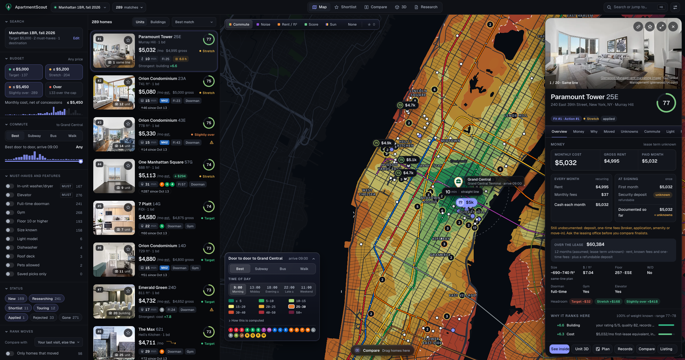</a> <b>The map, the ranked list and a home</b> Paramount Tower 25E in the drawer: a credited photo, a first-lease monthly cost of $5,032 against $4,995 gross, what is paid every month and at signing (the deposit is unknown), and $60,384 over a 12-month lease that is marked as assumed. The ranked cards sit on the left, the filter rail beside them.</td>
</tr>
<tr>
<td width="50%" valign="top"><a href="images/find-place-search.png">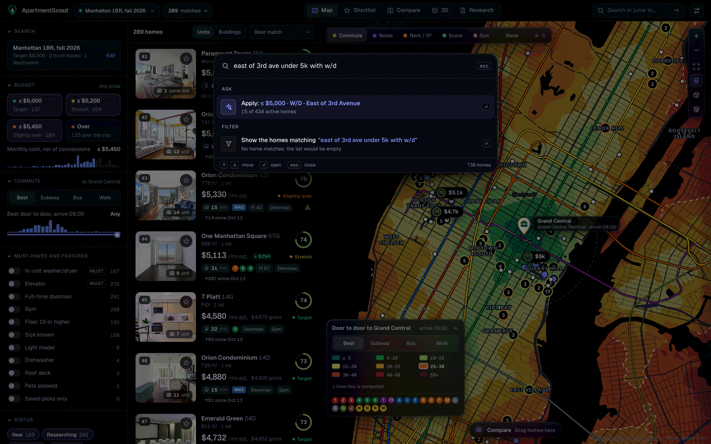</a> <b>Ask in plain words</b> The command menu with "east of 3rd ave under 5k with w/d" typed: the first row says what it understood (up to $5,000, W/D, east of 3rd Avenue) and counts 15 of 434 active homes before anything changes.</td>
<td width="50%" valign="top"><a href="images/find-building-pin.png">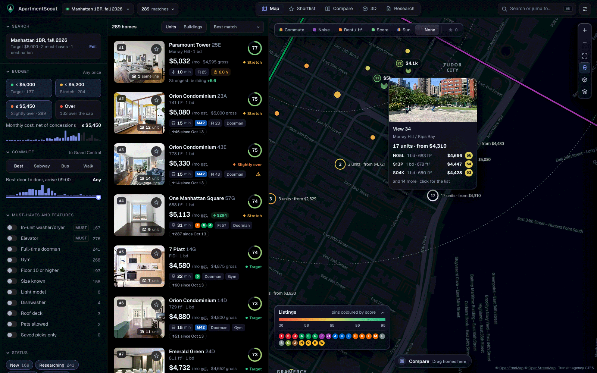</a> <b>A building is one pin</b> View 34 is one pin with its 17 units. Hovering it lists the best three with their size, price and score; clicking opens the whole list, and a row opens that home's drawer.</td>
</tr>
<tr>
<td width="50%" valign="top"><a href="images/find-pin-preview.png">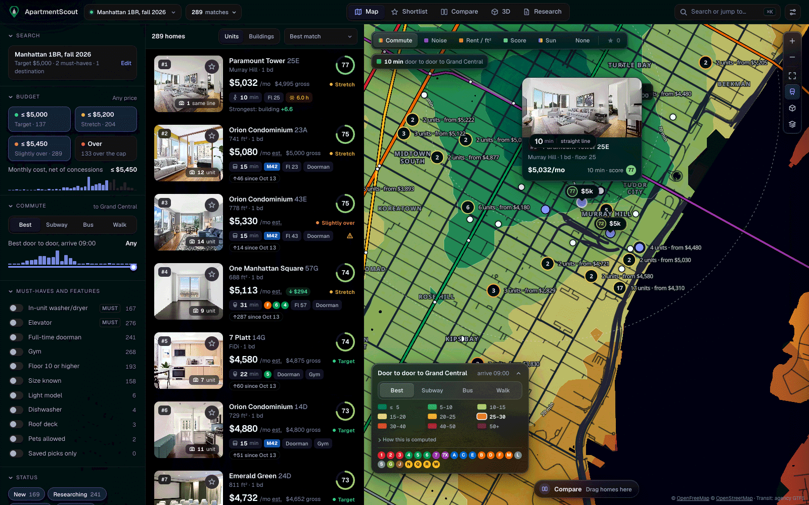</a> <b>Hover a pin, see the home</b> A card with the photo, rank, price, score and commute for Paramount Tower 25E appears without opening the drawer. On a phone the first tap shows the card and the second opens the drawer.</td>
<td width="50%" valign="top"><a href="images/find-route-preview.png">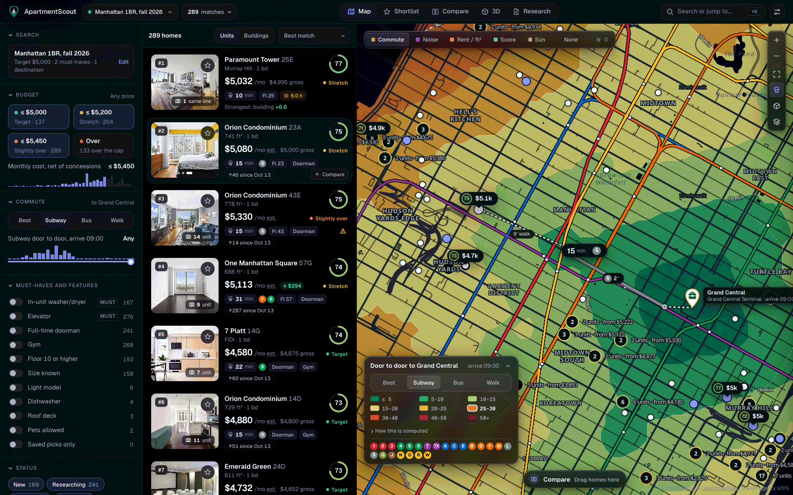</a> <b>Hover a card, see the trip</b> Subway lens: hovering Orion Condominium 23A draws its trip to Grand Central on the map, a 9-minute walk (dashed), the S shuttle on its own line, a short walk at the end and a 15-minute pill.</td>
</tr>
<tr>
<td width="50%" valign="top"><a href="images/find-rank-moves.png">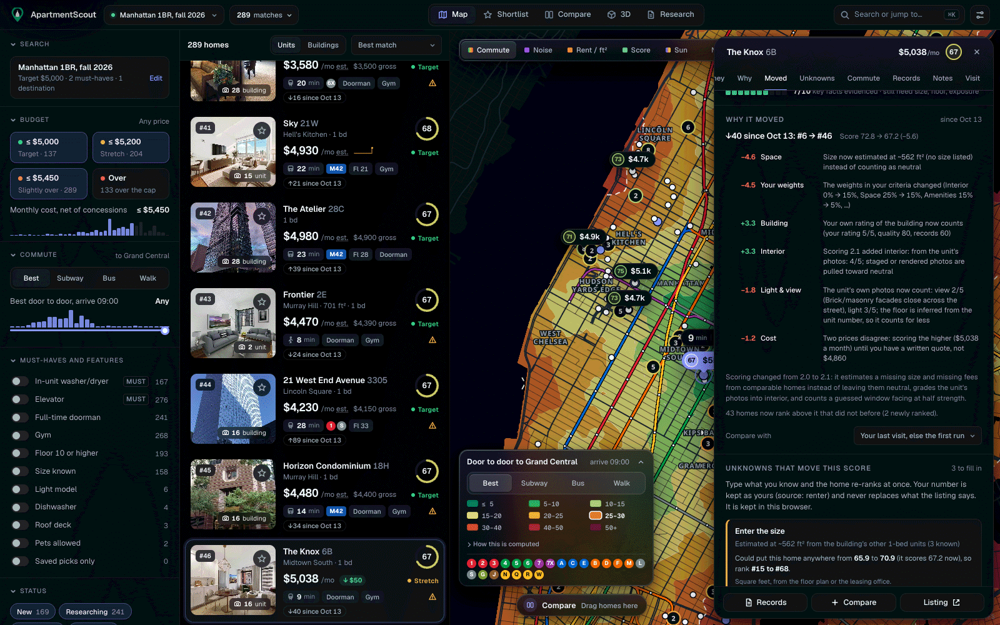</a> <b>Why a home moved</b> The Knox 6B fell from #6 to #46 since Oct 13 (the card says "↓40 since Oct 13"). The drawer's <i>Why it moved</i> lists each dimension with the points it moved, biggest first: size now estimated, the weights you changed, the unit's own photos, two prices that disagree.</td>
<td width="50%" valign="top"><a href="images/find-unknowns.png">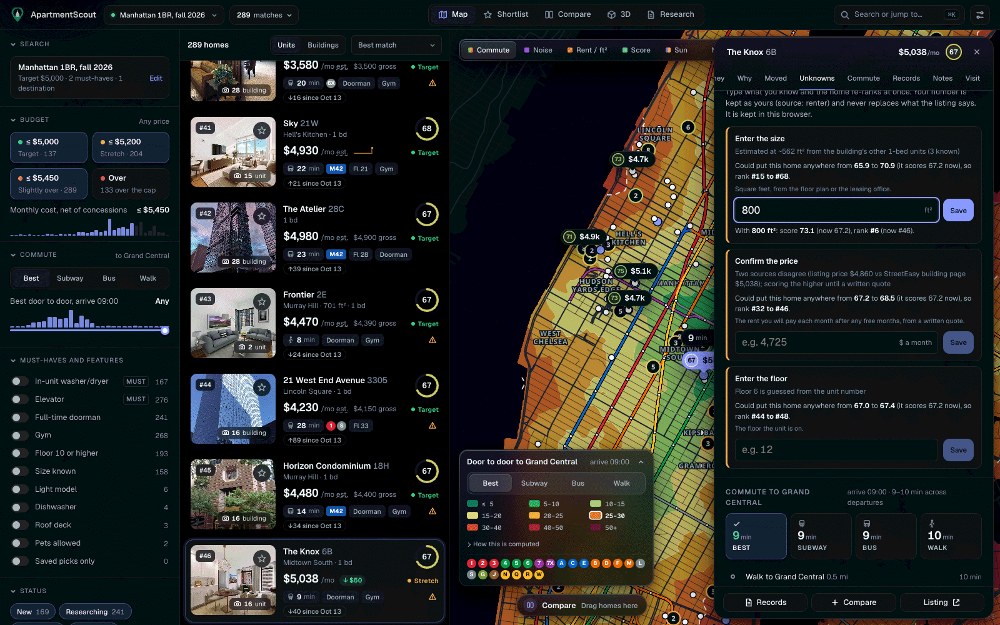</a> <b>Unknowns that move this score</b> For a home the scorer had to estimate, each unknown shows the range it spans and the ranks it could land in. Typing 800 ft² shows "score 73.1, rank #6 (now #46)" before you save; the number is kept as yours and the listing's own facts are untouched.</td>
</tr>
<tr>
<td width="50%" valign="top"><a href="images/find-price-audit.png">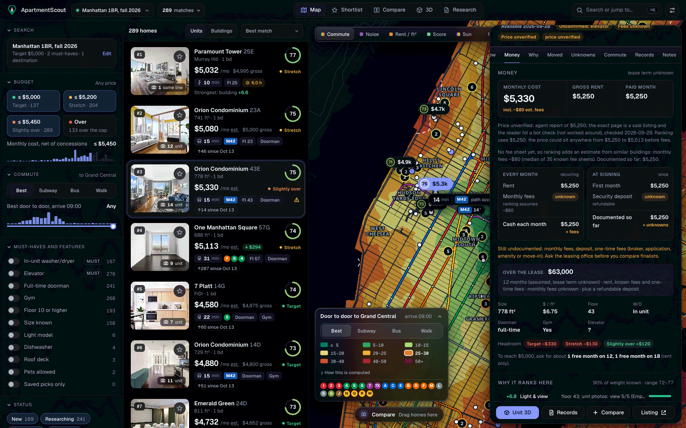</a> <b>What it costs, and is the price real?</b> The drawer's Money section on Orion Condominium 43E: monthly cost, what is paid every month and at signing, and the total over the lease. It carries "price unverified": the $5,250 came from an agent report and the unit page could not be read, so the drawer ranks on that price with a range, leaves the monthly fees unknown (the ranking assumes about $80) and lists what would bring it into each budget tier.</td>
<td width="50%" valign="top"><a href="images/find-price-drops.png">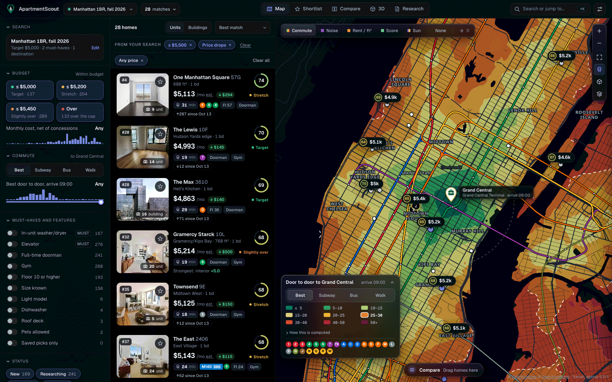</a> <b>Real price history</b> "Price drops under 5.5k" keeps the 28 homes whose latest recorded price move was down. Each card shows the size of the drop, for example $294 on One Manhattan Square 57G and $500 on Gramercy Starck 10L.</td>
</tr>
<tr>
<td width="50%" valign="top"><a href="images/find-drawer-commute.png">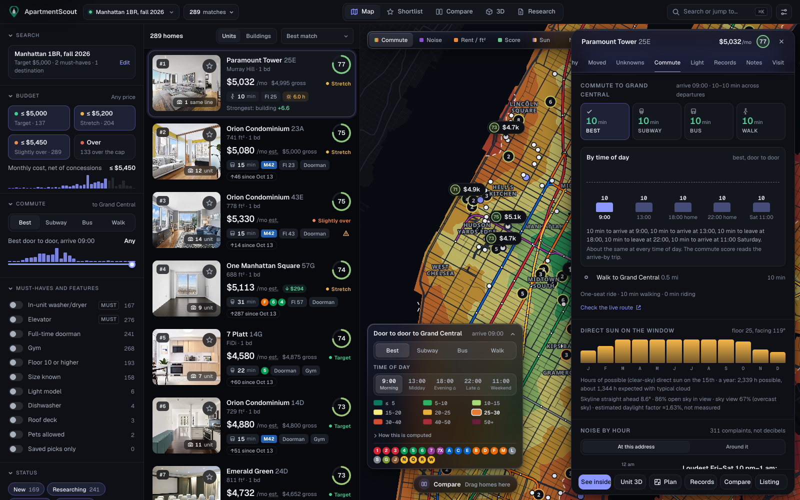</a> <b>Commute, sun and noise for one home</b> Paramount Tower 25E's drawer at Commute: 10 minutes to Grand Central by the best route, subway, bus and on foot, the same trip at 9:00, 13:00, 18:00, 22:00 and Saturday 11:00, then direct sun on the window month by month (about 1,344 hours a year expected with typical cloud) and 311 noise by hour.</td>
<td width="50%" valign="top"><a href="images/find-lightbox.png">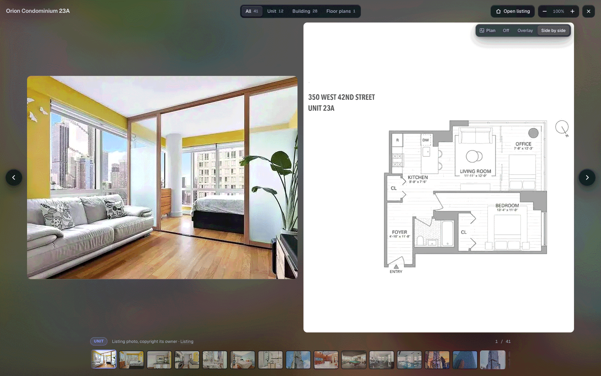</a> <b>Photos and the floor plan</b> The lightbox on Orion Condominium 23A: tabs for All 41, Unit 12, Building 28 and Floor plans 1, a thumbnail strip, the credit under the photo and the listing's own floor plan beside it (Plan, Side by side).</td>
</tr>
<tr>
<td width="50%" valign="top"><a href="images/find-map-clusters.png">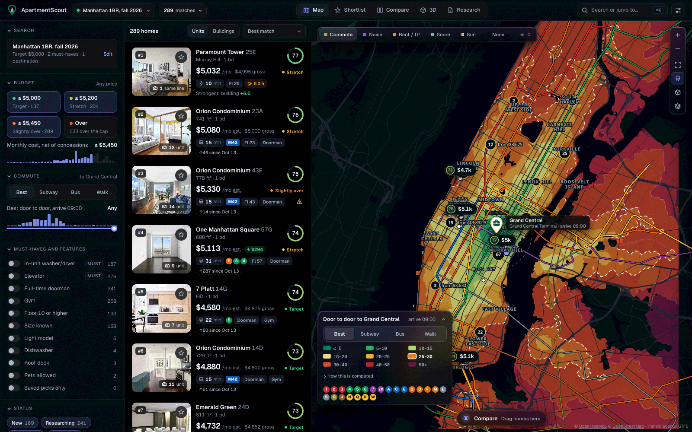</a> <b>A calmer map</b> Zoomed out, nearby homes merge into a bubble that counts them and shows the lowest monthly cost inside ("from $3,075"); click one to zoom in and watch it split. Your starred picks and the ten best-ranked homes keep a pin of their own at any zoom.</td>
<td width="50%" valign="top"><a href="images/find-light-theme.png">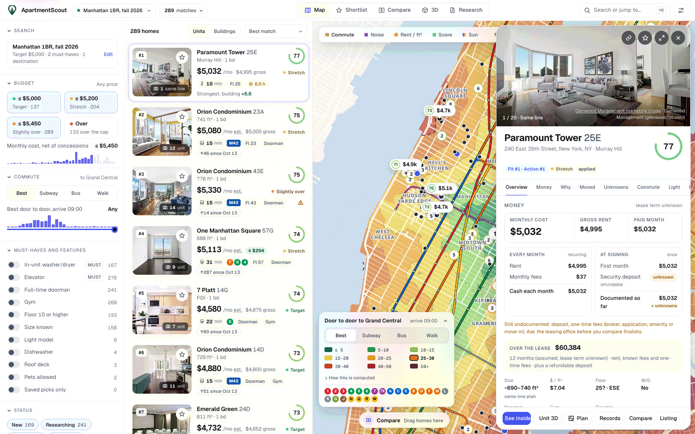</a> <b>The light theme</b> The same map and drawer in the light theme (the menu's Theme row, or <kbd>t</kbd>). Dark is the default, and a system setting is one click away.</td>
</tr>
<tr>
<td colspan="2" valign="top">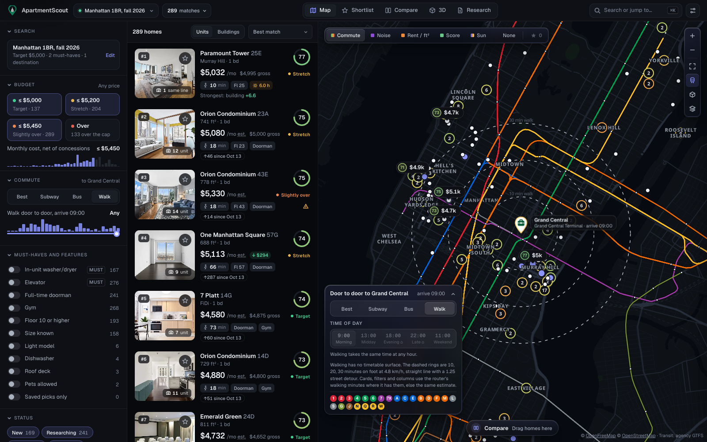 <b>On foot</b> The Walk mode of the commute panel: walking takes the same time at any hour, so the map draws dashed rings at 10, 20 and 30 minutes around Grand Central, and cards, filters and columns use walking minutes.</td>
</tr>
</table>

## See inside

Unit 3D puts you inside the exact unit, on its real floor, with the city through the glass. The Paramount Tower 25E views use the renter's own furniture (a black leather futon, the Bestier rotating desk with a 32 in monitor and an office chair, a black IKEA STORKLINTA dresser, the brown Latitude Run storage bed with black quilted bedding, two wall-mounted 55 in TVs, three paintings), finishes read from the unit's photos (a basket-weave parquet floor) and a facade bearing measured from their photos.

<table>
<tr>
<td colspan="2" valign="top"><a href="images/inside-unit-3d.png">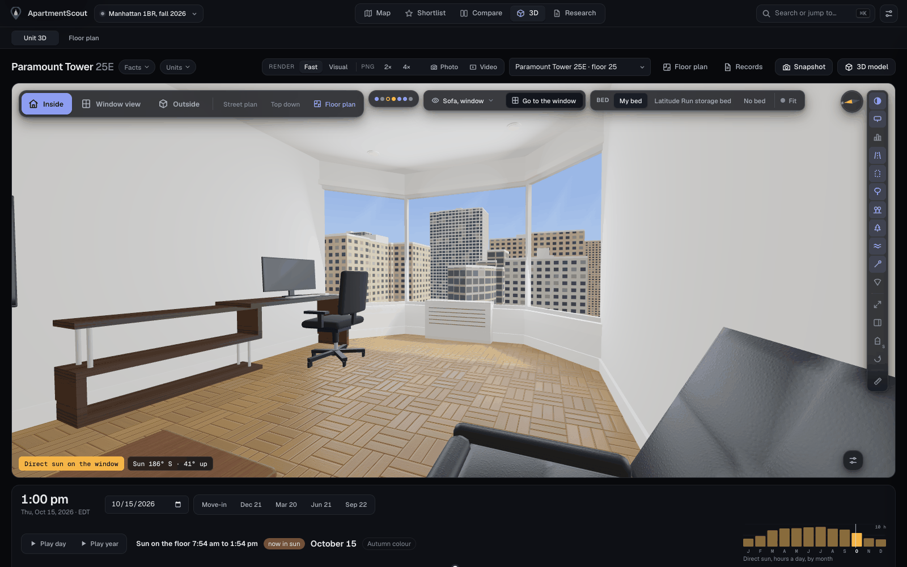</a> <b>Unit 3D lands inside the apartment</b> The 3D tab opens in the apartment at the 25th-floor slab height with a wide stage: the desk, its monitor and the one office chair by the bay window, the wall-mounted TV, a painting and the real city outside. The view picker and "Go to the window" are at the top, the day and year play bar and the sun hours by month below.</td>
</tr>
<tr>
<td width="50%" valign="top"><a href="images/inside-living-room.png">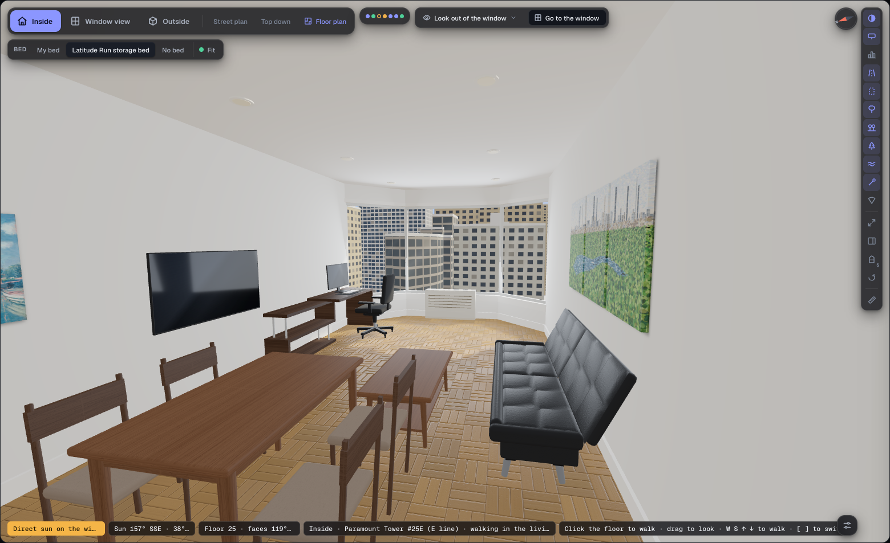</a> <b>Your furniture, paintings and the view</b> From the back of the living room toward the bay: the futon facing the TV, the dining table and chairs, the Bestier desk with its single office chair at the window, the Monet by the dining table and the Central Park triptych over the futon (shown here as a painted stand-in), with the towers beyond the glass. The two public-domain paintings ship with the dashboard; a private file wins over a stand-in.</td>
<td width="50%" valign="top"><a href="images/inside-furniture.png">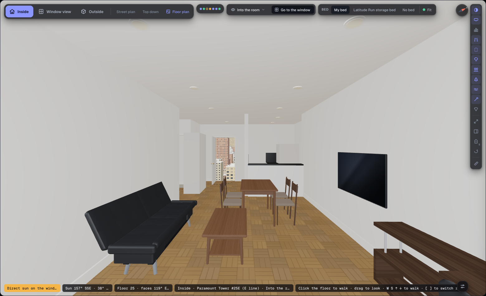</a> <b>The bedroom from its door</b> The brown Latitude Run storage bed with black quilted bedding, the wall-mounted 55 in TV and the tall dresser, a painting over the bed and the corner windows, at real sizes. Colours and materials say whether they are known or stand-ins.</td>
</tr>
<tr>
<td width="50%" valign="top"><a href="images/inside-bay.png">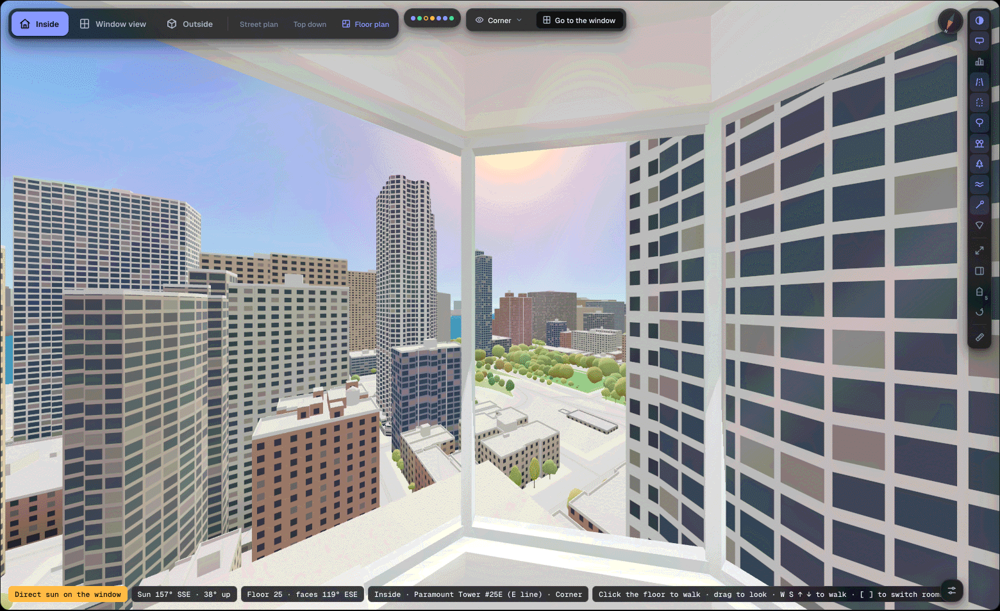</a> <b>Through the angled windows</b> The bedroom bay at 11:30 am, wide angle: the angled glass at the real height with the neighbouring towers, a park's canopy and the river, the radiator cover and the bed's headboard. Chips switch between rooms, bays, corners and the seats (sofa, bed, desk, each also looking out of the window).</td>
<td width="50%" valign="top"><a href="images/inside-bedroom.png">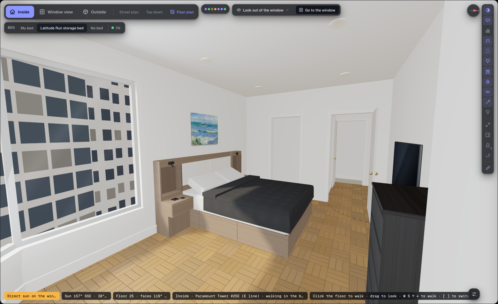</a> <b>The bedroom</b> The bedroom from its window end: the whole storage bed with its black quilted bedding and nightstand, the Van Gogh seascape over the headboard, the dresser and the TV, and the tower across the street in the glass.</td>
</tr>
<tr>
<td width="50%" valign="top"><a href="images/inside-night-window.png">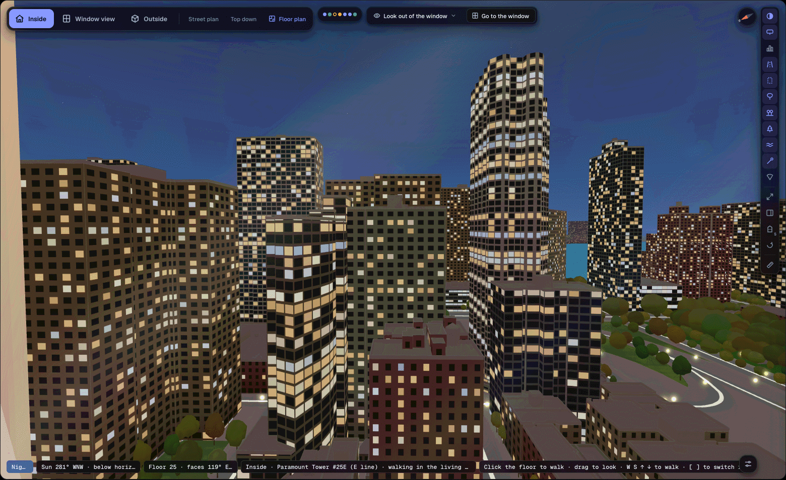</a> <b>The night city</b> 8:30 pm at the same window: thousands of buildings around the unit with lit facades, the street lamps along the road and the park in the dark, and the night sky.</td>
<td width="50%" valign="top"><a href="images/inside-measure-tape.png">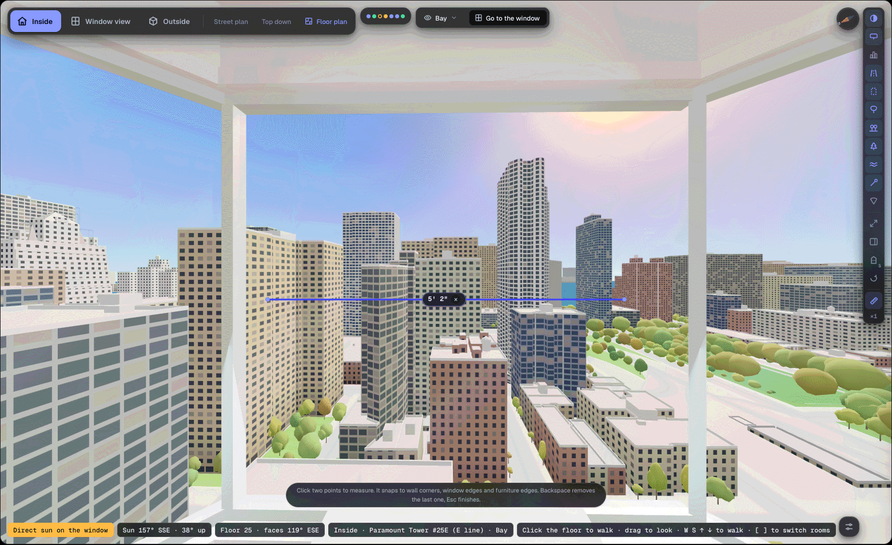</a> <b>The measuring tape</b> The tape tool in the right-hand column: click two points and it snaps to wall corners, window edges and furniture edges. It reads 5' 2" across the bay. The same tape works in the studio's 2D plan and 3D room, and the readings are kept with the plan.</td>
</tr>
<tr>
<td width="50%" valign="top"><a href="images/inside-fits.png">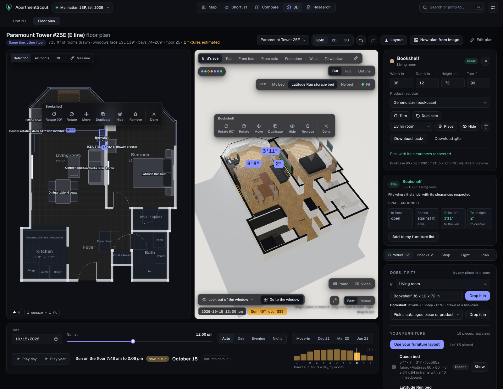</a> <b>Does it fit?</b> In the studio, type "Bookshelf 36 x 12 x 72 in" (or pick a catalogue piece or a product) and drop it in a room: it is drawn at its real size and judged, with the space on each of its four sides, and can be added to your furniture list.</td>
<td width="50%" valign="top"><a href="images/inside-match-photo.png">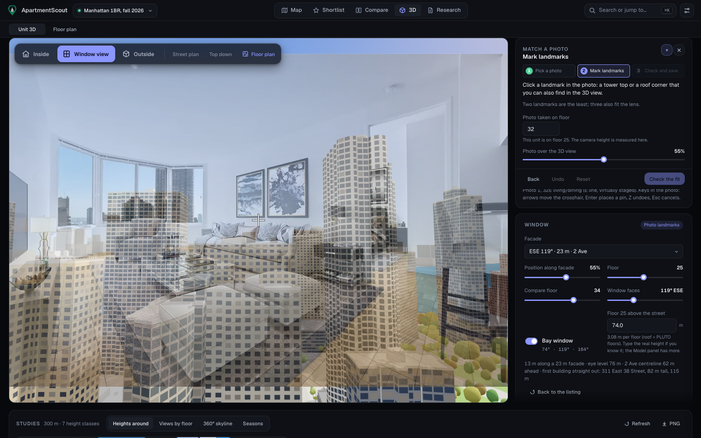</a> <b>Match a photo</b> From the Window view, <i>Match a photo</i> lays one of the listing's photos over the 3D view at an opacity you set. Mark two or three landmarks (a tower top, a roof corner) and it fits the camera, then reports how well the model's window, bearing and floor agree with the photographer's.</td>
</tr>
<tr>
<td colspan="2" valign="top"><a href="images/inside-measured-chip.png">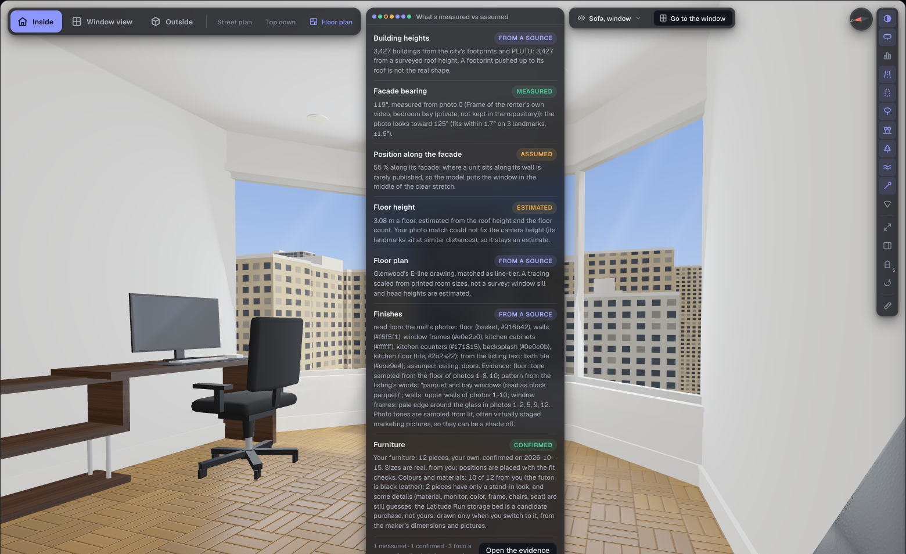</a> <b>Measured, sourced or assumed</b> The chip open: building heights from a source, the facade bearing of 119 degrees measured against landmarks in the renter's photos, the position along the facade assumed, the floor height estimated, the floor plan and the finishes from sources, and the furniture confirmed by the renter.</td>
</tr>
</table>

## Sun and light

Direct sun is worked out for the window from the buildings around it: by floor, by month, by hour, and with the building that blocks it named. Trees are context and never count as shade.

<table>
<tr>
<td width="50%" valign="top"><a href="images/sun-low-floor.png">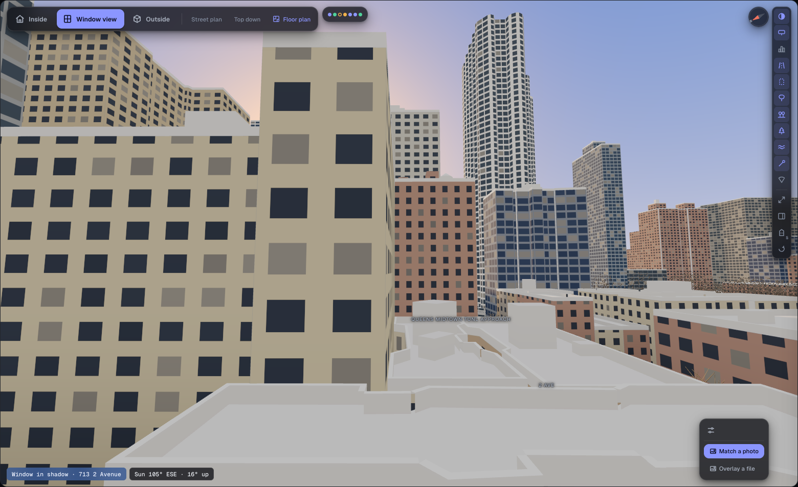</a> <b>Floor 8: in shadow</b> The same window line on floor 8, March 20 at 8:30 am. The HUD says "Window in shadow · 713 2 Avenue": the sun is 16 degrees up in the east-south-east, behind the building across the avenue, and the view is its facade and the low roofs.</td>
<td width="50%" valign="top"><a href="images/sun-high-floor.png">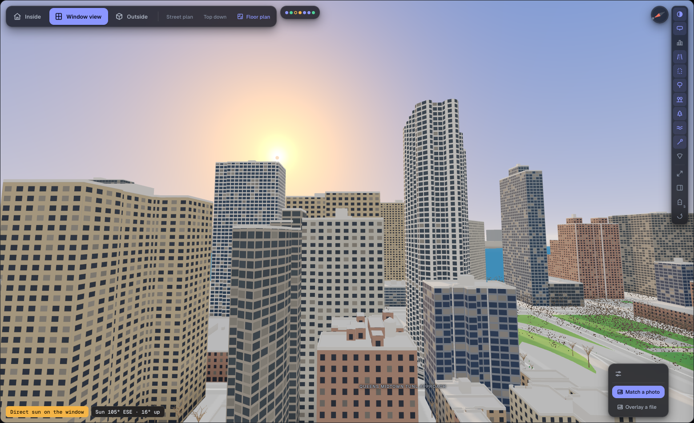</a> <b>Floor 25, same moment: direct sun</b> Floor 25 at the same date and time: "Direct sun on the window". The sun clears the roofs that shade floor 8, and the view opens to the towers, a park's lawn and a strip of the East River.</td>
</tr>
<tr>
<td width="50%" valign="top"><a href="images/sun-winter-shadows.png">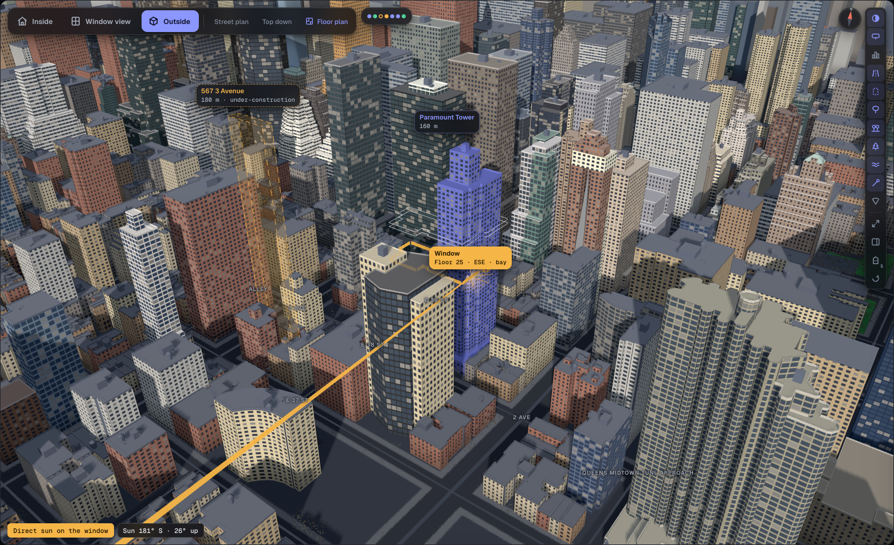</a> <b>December 21, noon</b> Outside at noon on December 21: the sun due south and 26 degrees up, long shadows across the streets and facades, the sun ray reaching the 25th-floor window, and 567 3 Avenue (under construction) drawn dashed.</td>
<td width="50%" valign="top"><a href="images/sun-summer-shadows.png">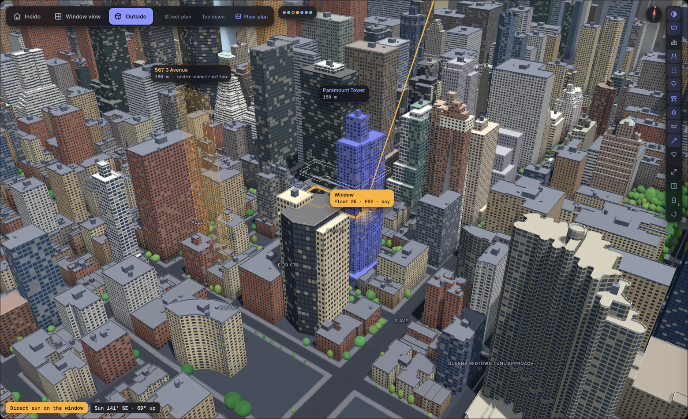</a> <b>June 21, noon</b> The same camera at noon on June 21: the sun 69 degrees up in the south-east, short shadows, trees in leaf along the streets, and the sun ray dropping steeply to the window.</td>
</tr>
<tr>
<td width="50%" valign="top"><a href="images/sun-path-chart.png">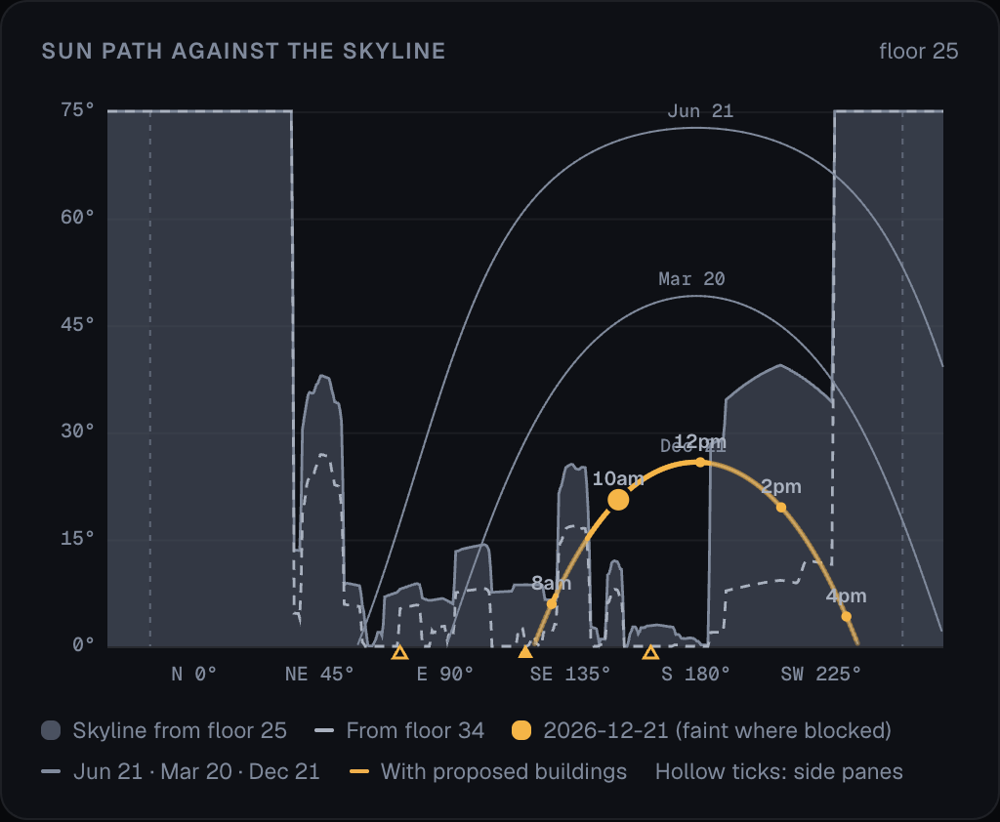</a> <b>Sun path against the skyline</b> From the 25E window: the skyline as seen from floor 25 (filled) and from floor 34 (dashed), the sun's arcs on June 21, March 20 and December 21, and December 21 hour by hour, faint where a building blocks it. Ticks mark the side panes of the bay.</td>
<td width="50%" valign="top"><a href="images/inside-sun-by-floor.png">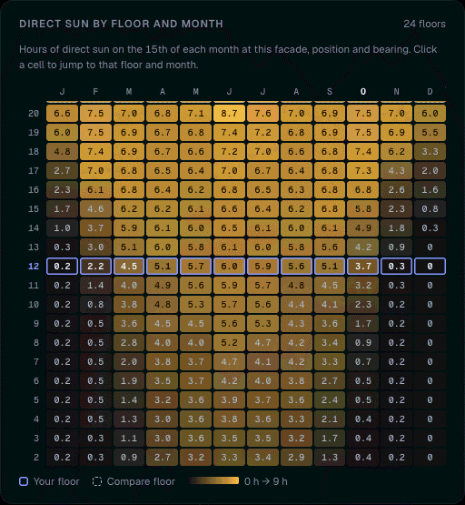</a> <b>Sun by floor and month</b> Emerald Green 1211's facade: hours of direct sun on the 15th of each month for every floor, from 0 to 9 hours, with floor 12 outlined as the chosen floor. A click jumps the 3D view to that floor and month.</td>
</tr>
<tr>
<td width="50%" valign="top"><a href="images/sun-plan-view.png">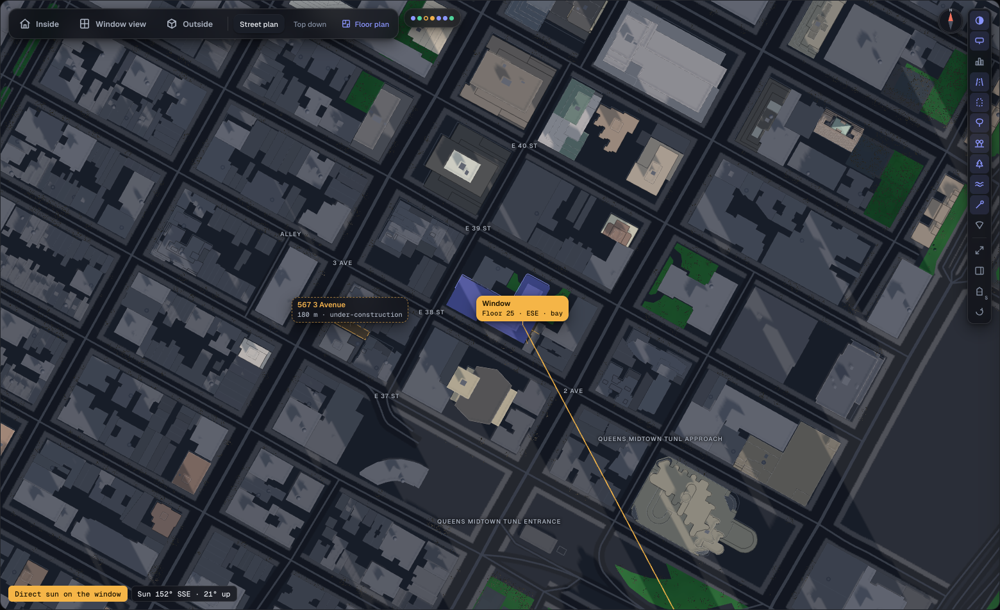</a> <b>From above: what stands in the way</b> Street plan, December 21 at 10 am: the tower from straight above among its neighbours and their shadows, with the sun's line running to the window, so you can see which building would stand between the window and the sun at any hour.</td>
<td width="50%" valign="top"><a href="images/inside-play-year.png">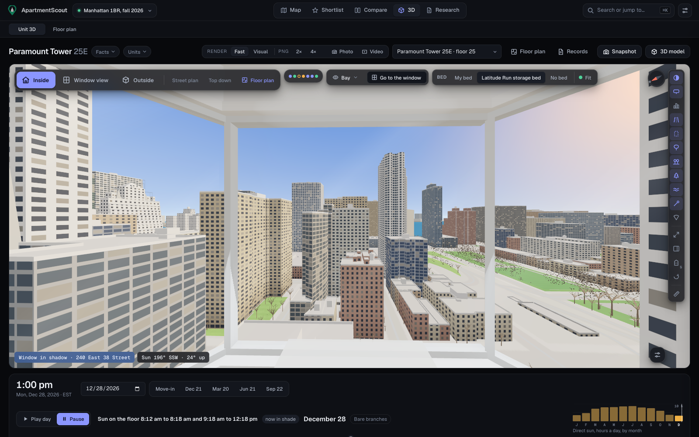</a> <b>Play the day, play the year</b> The play bar moves the sun across the day or through the months at one time of day. Here it has reached December 28: the trees are bare, the window is in shadow, and the strip says so. Trees change with the season and never count as shade in the sun numbers.</td>
</tr>
<tr>
<td width="50%" valign="top"><a href="images/inside-orbit-day.png">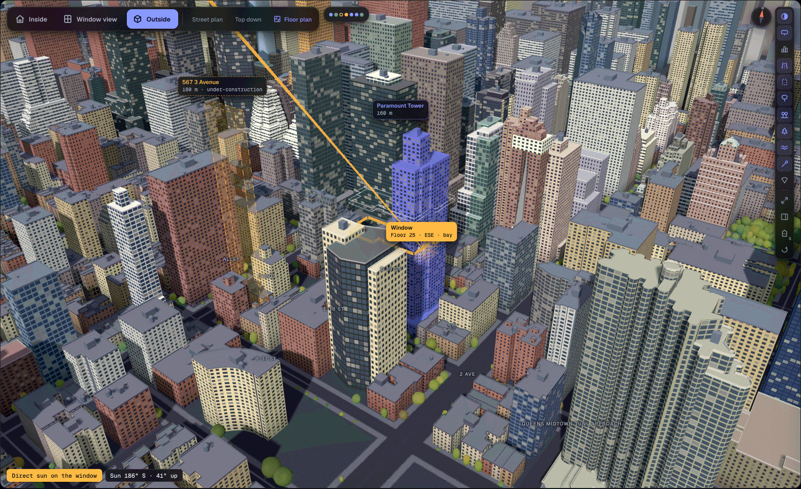</a> <b>By day</b> Outside, by day: the window on floor 25 facing ESE (a bay), the sun ray to it, a tower under construction drawn dashed and street trees.</td>
<td width="50%" valign="top"><a href="images/inside-orbit-night.png">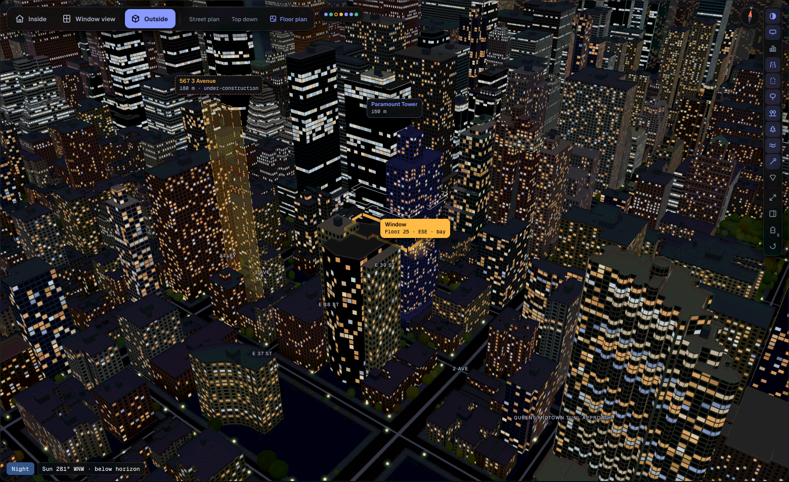</a> <b>And at night</b> 8:30 pm: facades are shader-drawn with lit windows, the sun is below the horizon and the HUD says Night.</td>
</tr>
</table>

## The city in 3D

Each site model holds thousands of buildings from open footprints and heights, with landmarks built from their parts, water, parks, street trees and permitted towers drawn dashed.

<table>
<tr>
<td colspan="2" valign="top"><a href="images/city-building-models.png">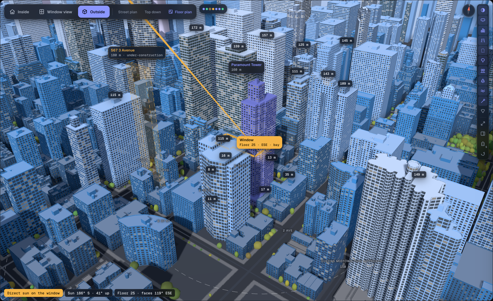</a> <b>Every building around the tower, with its height</b> The Heights layer: every building around the tower coloured by height class with its roof height labelled (Paramount Tower 160 m, 567 3 Avenue 180 m and under construction), a 150 m ring on the ground and the window marked on floor 25.</td>
</tr>
<tr>
<td width="50%" valign="top"><a href="images/city-map-3d.png">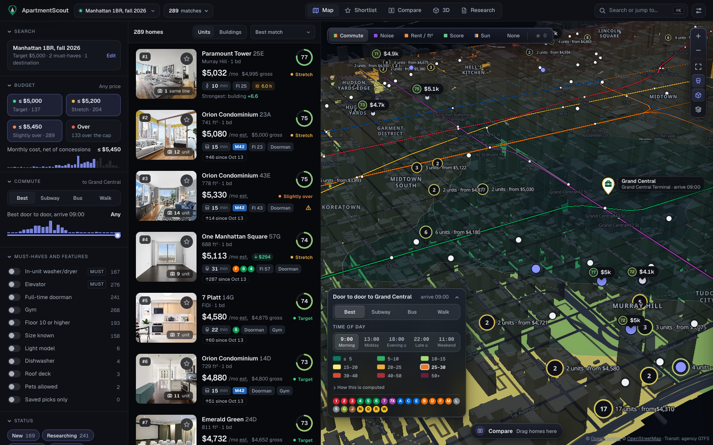</a> <b>The map in 3D</b> <i>Tilt with 3D buildings</i> on the map: OpenStreetMap buildings rise over the commute layer, with the price tags, the subway lines and Grand Central, from Hudson Yards to Murray Hill.</td>
<td width="50%" valign="top"><a href="images/inside-river.png">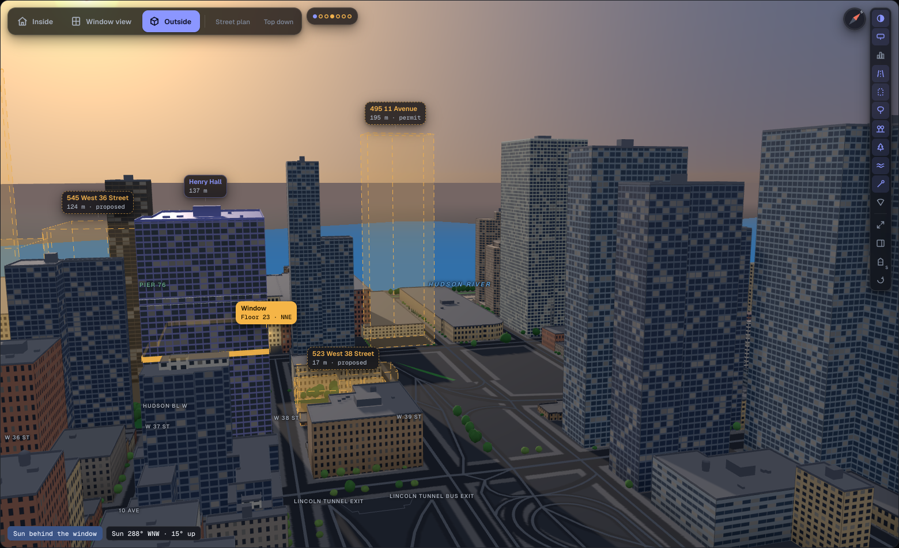</a> <b>Water and permitted towers</b> Henry Hall 23J on June 21 at 7 pm: the Hudson River and the piers from surveyed hydrography, and proposed and permitted towers drawn dashed where they will stand. The sun is behind the facade.</td>
</tr>
<tr>
<td width="50%" valign="top"><a href="images/inside-park-trees.png">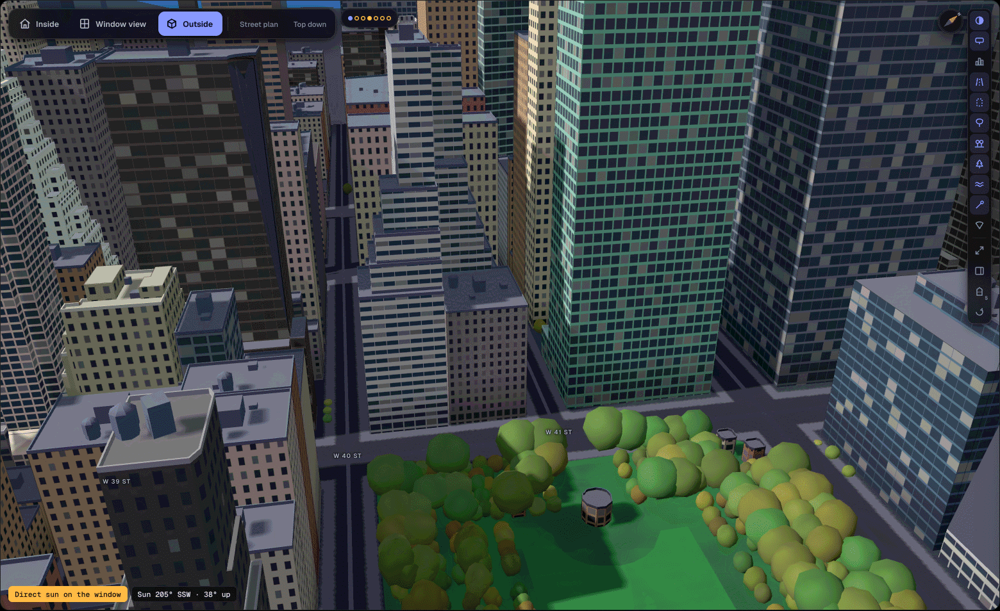</a> <b>Parks and trees</b> Atlas 38D, floor 38, at 2 pm in October: a park drawn as a lawn with its trees from the NYC Parks inventory in autumn colour, and street trees along the avenues. They are context and are never counted as shade in the sun hours.</td>
<td width="50%" valign="top"><a href="images/inside-light-theme.png">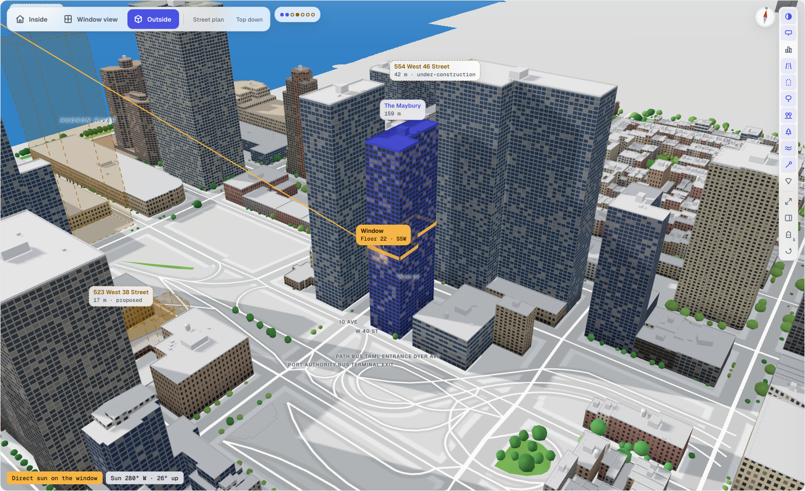</a> <b>The light theme</b> The Maybury, floor 22, at 6 pm on June 21: direct sun on the window from the west (280 degrees), with the Hudson River beyond, in the light theme.</td>
</tr>
</table>

## Floor-plan studio

The Floor plan studio draws the same room as Unit 3D: a piece placed in one stays there in the other.

<table>
<tr>
<td width="50%" valign="top"><a href="images/inside-floor-plan.png">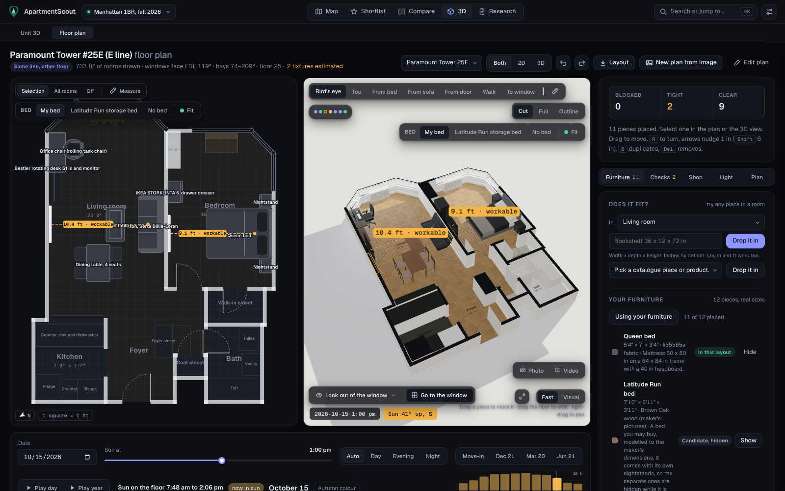</a> <b>Bird's eye beside the plan</b> The Paramount Tower 25E plan in 2D and 3D with "Using your furniture" and the Does it fit? panel in the right-hand column. Drag a piece in either view and it moves in both; sun patches, fit checks, the tape and eye-level cameras are in the same studio.</td>
<td width="50%" valign="top"><a href="images/studio-top.png">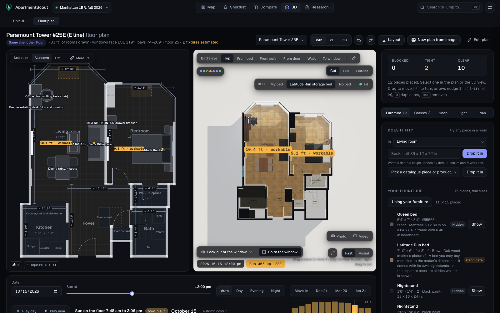</a> <b>Top down, with every dimension</b> The Top camera with every room's dimensions on (<i>All rooms</i>): the 10.4 ft and 9.1 ft walkways marked workable, and the blocked, tight and clear counts (0, 2 and 9) for the pieces placed.</td>
</tr>
<tr>
<td width="50%" valign="top"><a href="images/studio-light.png">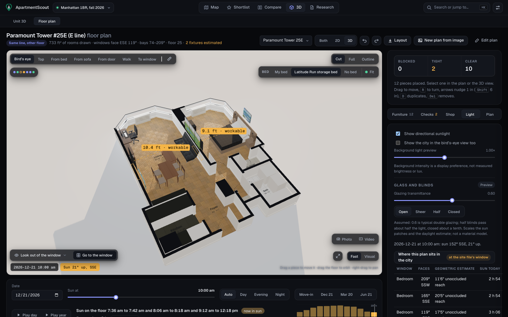</a> <b>The light tab</b> The 3D room alone on December 21 at 10 am with the Light tab: directional sunlight on the floor, glazing transmittance and blinds (open, sheer, half, closed), and for each window its facing, its unoccluded reach and its sun today.</td>
<td width="50%" valign="top"><a href="images/studio-tracer.png">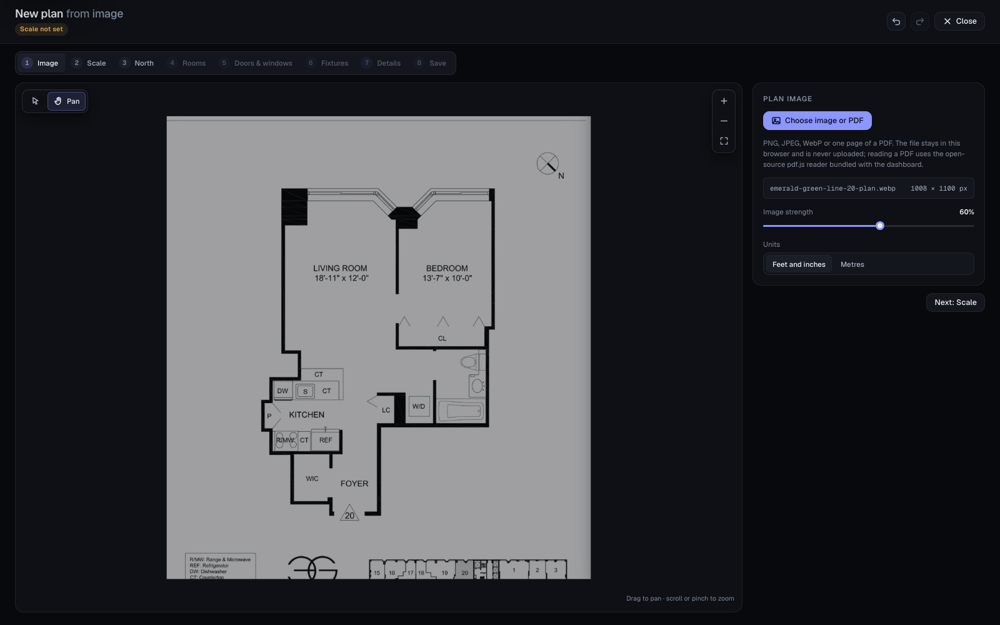</a> <b>Trace a plan from an image</b> <i>New plan from image</i>: a listing's floor plan (an Emerald Green line) loaded as the backdrop, then eight steps: image, scale, north, rooms, doors and windows, fixtures, details and save. The image or PDF page stays in the browser.</td>
</tr>
</table>

## Compare

Put finalists side by side, in a table or in 3D, trade the weights against each other and watch the ranking move.

<table>
<tr>
<td width="50%" valign="top"><a href="images/compare-four.png">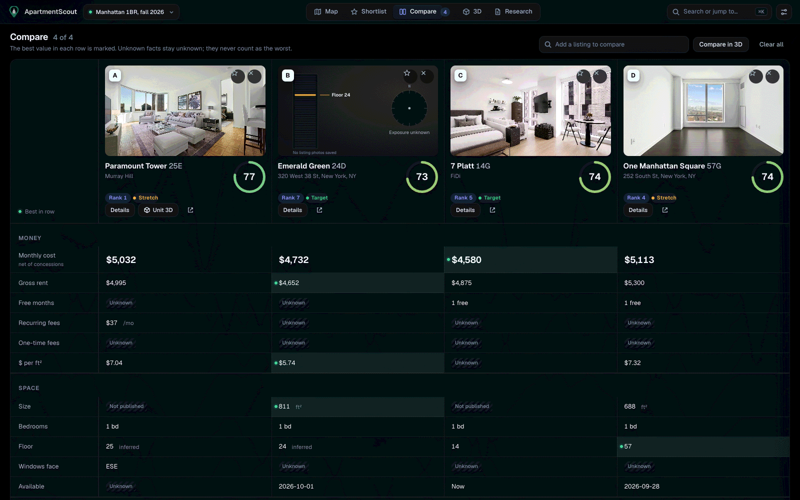</a> <b>Four finalists, row by row</b> Paramount Tower 25E, Emerald Green 24D, 7 Platt 14G and One Manhattan Square 57G in columns A to D, with money, space and commute rows below. The best value in each row is marked, and a fact nobody has confirmed (free months, fees, size) reads "Unknown" and never counts as the worst.</td>
<td width="50%" valign="top"><a href="images/compare-side-by-side-3d.png">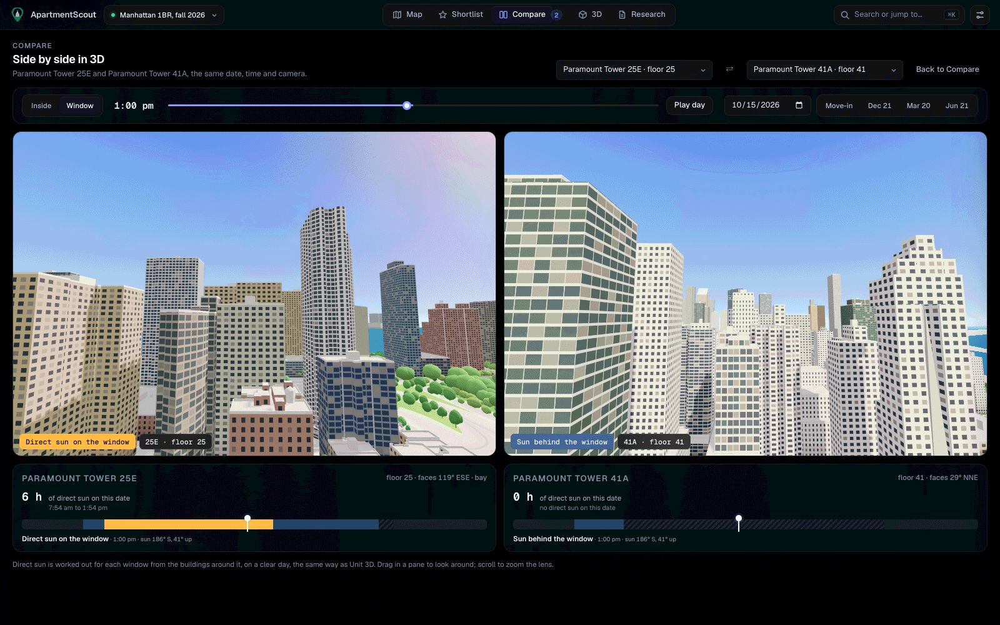</a> <b>Two units side by side in 3D</b> Compare in 3D opens two homes in one view with the same date, time and camera (Inside or Window) and one time slider. Each pane has its own direct-sun readout: Paramount Tower 25E, floor 25, gets 6 hours on this date and 41A, floor 41, none.</td>
</tr>
<tr>
<td width="50%" valign="top"><a href="images/compare-tradeoff-pad.png">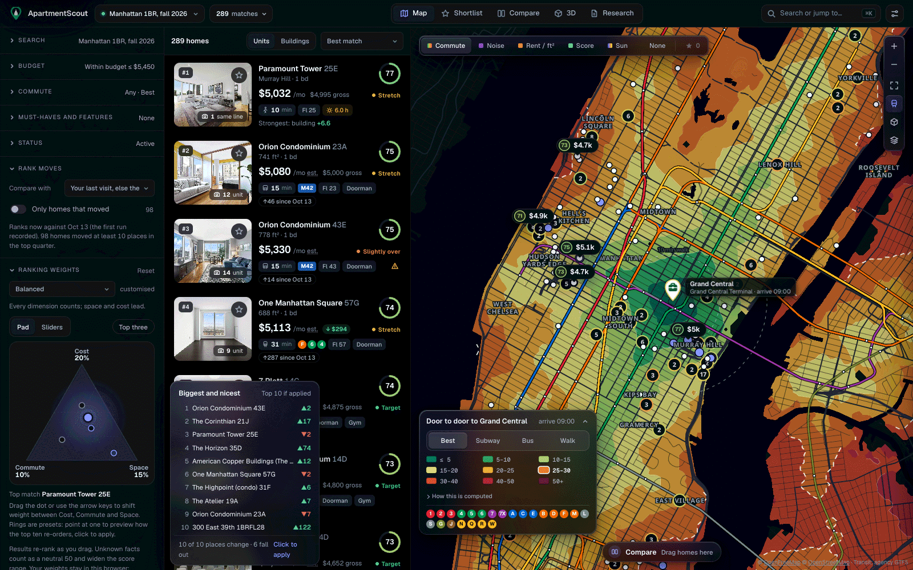</a> <b>The trade-off pad</b> One dot trades Cost, Commute and Space against each other. Pointing at the Biggest and nicest ring previews the top ten if it were applied: ten of ten places change and six homes fall out. Clicking applies it through the same weights as the sliders.</td>
<td width="50%" valign="top"><a href="images/compare-split-view.png">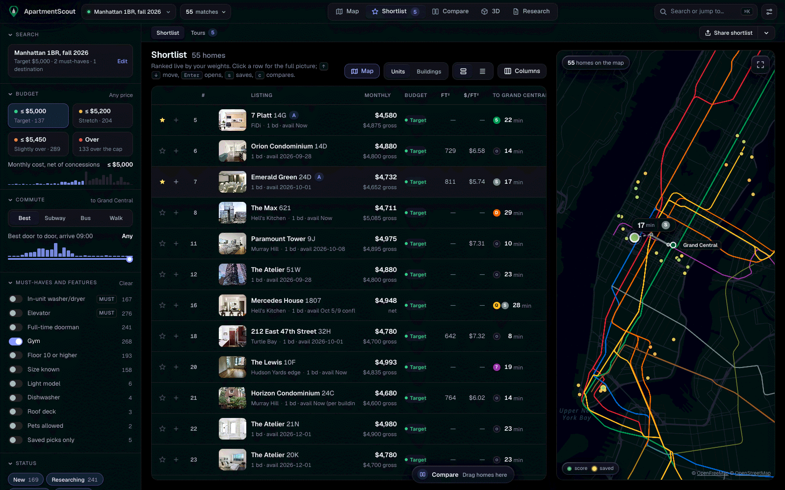</a> <b>The shortlist beside its map</b> Shortlist split view: 55 homes in the Target tier with a gym, next to a map of exactly those homes. Hovering Emerald Green 24D previews its 17-minute subway trip.</td>
</tr>
</table>

## Decide

Read the records, ask the leasing office, visit, plan the tours, then share a page or a memo.

<table>
<tr>
<td width="50%" valign="top"><a href="images/decide-records.png">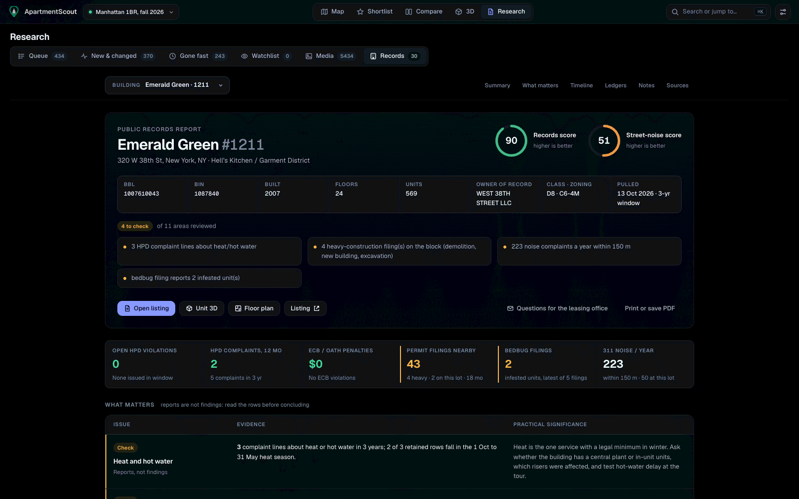</a> <b>Building records</b> The due-diligence report for Emerald Green #1211: a records score of 90 and a street-noise score of 51, four areas to check (heat and hot water complaints, heavy construction nearby, 311 noise, bedbug filings) and a "What matters" table that labels every item a report, not a finding.</td>
<td width="50%" valign="top"><a href="images/decide-office-questions.png">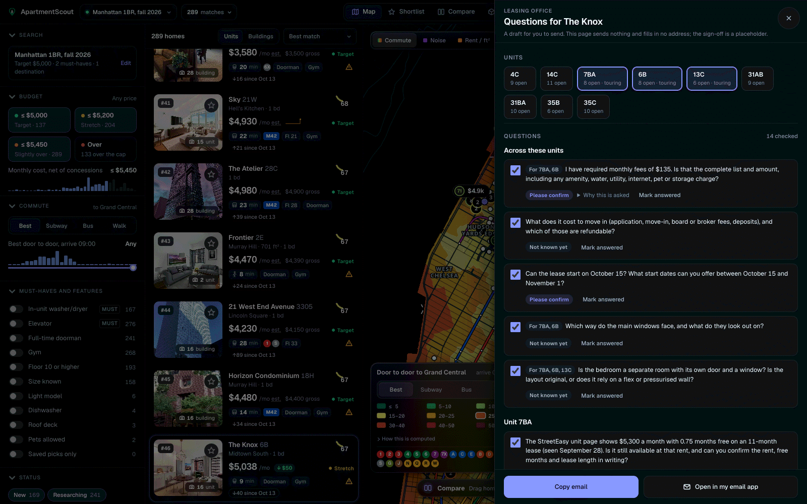</a> <b>Questions for the leasing office</b> The side sheet for The Knox: its units with their open questions, a checkbox per question (14 checked), "Why this is asked" for the evidence, then the subject and message below. Copy email, or Open in my email app: a <code>mailto:</code> link with no recipient. Nothing is sent from the page.</td>
</tr>
<tr>
<td width="50%" valign="top"><a href="images/decide-visit-history.png">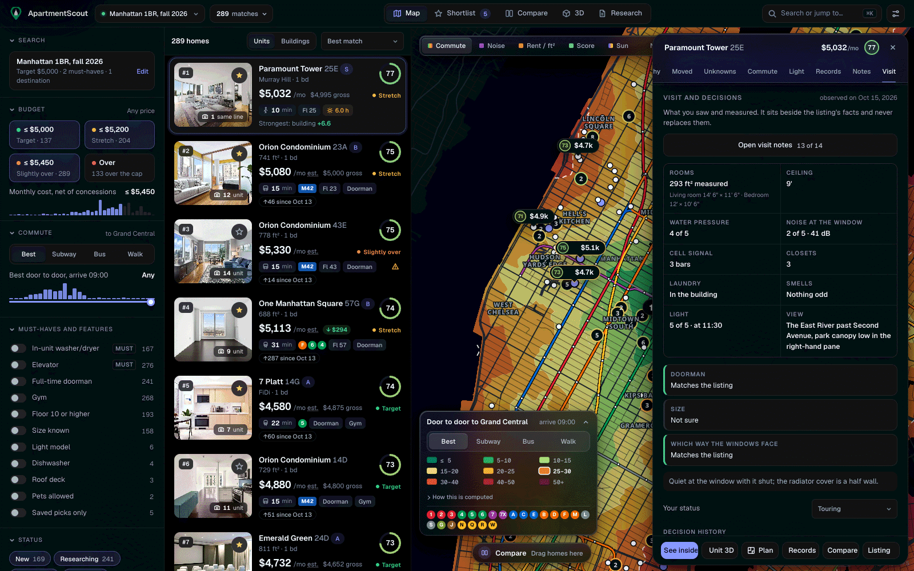</a> <b>Visit notes and history</b> Sample notes from a visit to Paramount Tower 25E: rooms measured (293 ft²), ceiling, water pressure, noise at the window with a dB reading, signal, laundry, light with the time, the view, and whether the doorman, size and windows match the listing. The dated history of every star, tier and status change sits below.</td>
<td width="50%" valign="top"> <b>The tours board</b> The Tours tab: saved picks in To sort, S, A, B, C and Pass lanes (drag between them or use the tier buttons), each with a tour time, notes and <i>Start visit notes</i>, and the tour plan below, ordered from Grand Central with the walking minutes.</td>
</tr>
<tr>
<td width="50%" valign="top"> <b>The tour-day planner</b> Five stops from 10:00 am to 3:10 pm: when to leave by for each hop, walking or an estimated transit trip, a viewing time and a buffer, and a warning where a booked time is later than the plan. Add to calendar and Copy plan are at the top right.</td>
<td width="50%" valign="top"> <b>The decision memo</b> A ranked table of the five saved homes with money, size, commute, score, tier and open items, then the weights that mattered and a page per home. Print it or save it as a PDF; your notes stay out unless you tick them.</td>
</tr>
<tr>
<td width="50%" valign="top"> <b>A page to send</b> The read-only Share shortlist page: five homes, a median of $5,032 a month, a schematic map with the subway lines and a ranked list, then a card per home with its photos, price and reasons.</td>
<td width="50%" valign="top"> <b>What you still don't know</b> The Research tab: the finalist standard (none of the 434 open homes has every fact yet), counts of missing size, fees and media, and a queue ranked by the points each unknown could swing, with questions ready to copy for the leasing office.</td>
</tr>
<tr>
<td colspan="2" valign="top"> <b>What rented, and how fast</b> Research, <i>Gone fast</i>: the lesson first (good units at your budget go in 5 days, the median of the five with both dates), days on market as a histogram, then each unit that went with its dates, days on market, last price and budget tier.</td>
</tr>
</table>

## Set up

Start a search in any city from the dashboard, the terminal or an agent.

<table>
<tr>
<td width="50%" valign="top"> <b>The new search wizard</b> Step 1 of 8 (<code>?new=1</code>, or New search in the menu): a search name and the city, here Another city with Chicago typed in. Each step's answer is summarised on the left and a draft is kept in the browser. Served locally it also looks the city up.</td>
<td width="50%" valign="top"> <b>Review the criteria.yaml</b> The last step shows the generated <code>criteria.yaml</code>, a diff against the open search and, because this page cannot write files, Copy YAML, Apply as preview and Download criteria.yaml.</td>
</tr>
<tr>
<td width="50%" valign="top"> <b>One menu</b> The top-right menu: this search (edit criteria, settings, new search), data (CSV, back up and restore picks, share, decision memo), appearance (theme, accent, density, office pin, golden-hour tint), comfort (motion, transparency, contrast, text size) and help.</td>
<td width="50%" valign="top"> <b>The command line</b> Real output on the example: <code>apartmentscout city</code> says what the city has (geocoding, OpenStreetMap buildings, streets and parks, floor plans, NYC open data, three GTFS feeds), and <code>score --top 10</code> prints the ranking.</td>
</tr>
</table>

## On a phone

The layout follows the screen; the dashboard installs as an app and works offline.

<table>
<tr>
<td width="16%" valign="top"> <b>Map and cards</b> The commute map on top, ranked cards in a sheet below, and a bottom tab bar.</td>
<td width="16%" valign="top"> <b>A listing</b> The drawer slides up over the map: the credited photo, score, tabs from Overview to Commute, the money first, and See inside, Unit 3D and Plan in the bar.</td>
<td width="16%" valign="top"> <b>Unit 3D</b> Inside, from "Sofa, window", with the camera modes, the view picker, the bed switch, the layers button and the play bar. The 3D scene is tuned to stay smooth on a phone.</td>
<td width="16%" valign="top"> <b>Visit notes</b> Sample notes opened with <code>?visit=&lt;listing-id&gt;</code> for one hand at the home: big steppers, rooms with their areas, and the camera in the bar below.</td>
<td width="16%" valign="top"> <b>Tour day</b> Today's tours in time order (or shortest walk), each with Directions, the checklist progress and the minutes to the next stop; sample tours booked for the day of the shot.</td>
<td width="16%" valign="top"> <b>The checklist</b> One question at a time at the home: light at the window (1 to 5) with the time saved, which way it faces, noise with the windows shut, each with why it matters to your weights. Answers flow into the visit notes and the score.</td>
</tr>
</table>

<b>Earlier tools from the search</b>: the one-off prototypes the dashboard grew out of (click to open)

The one-off tools an agent built during the Manhattan search, kept as design references and as examples
of what an agent can produce with this workflow. *Each was a prototype built by an agent during the
search.*

### First search dashboard

Every unit inside the commute radius on a styled Manhattan map with subway lines, filters, budget tiers,
weights, watchlist, gone-fast, compare and tour plan. Light and dark.

<table>
<tr><td width="50%"> Dark mode, ranked by nicest and biggest</td><td width="50%"> Light mode home</td></tr>
<tr><td width="50%"> All units table</td><td width="50%"> New and changed listings</td></tr>
<tr><td width="50%"> Gone fast: what rented and how quickly</td><td width="50%"> My list</td></tr>
<tr><td width="50%"> Compare</td><td width="50%"> Compare, dark</td></tr>
<tr><td width="50%"> Tour plan</td><td width="50%"> Tour plan, dark</td></tr>
<tr><td width="50%"> Playbook</td><td></td></tr>
</table>

### Codex research site

A multi-page research site: unit sheet, building rankings, space research, shortlist and tours, personal
picks and dated research reports.

<table>
<tr><td width="50%"> Find the biggest, nicest options</td><td width="50%"> Every unit on one sheet</td></tr>
<tr><td width="50%"> Every researched building</td><td width="50%"> Shortlist and tours</td></tr>
<tr><td width="50%"> My picks</td><td width="50%"> Research report, Sep 28</td></tr>
</table>

### First commute heat map

The first commute heat map to a Midtown office near Grand Central.

<table>
<tr><td width="50%"> Commute heat map</td><td></td></tr>
</table>

### Emerald Green 1211 light and view model

Real NYC footprints and roof heights, live sun for any date and time, the view from the window, sun path
against the skyline, landmark visibility and direct sun by floor and month. The Unit 3D view generalises it
to any listing with a site model.

<table>
<tr><td width="50%"> Oct 15, 1 pm: orbit view with the sun ray</td><td width="50%"> From the 12th-floor window</td></tr>
<tr><td width="50%"> From the 21st floor, same line</td><td width="50%"> December 21 at noon</td></tr>
<tr><td width="50%"> Sun paths against the skyline</td><td width="50%"> Direct sun hours by floor and month</td></tr>
<tr><td width="50%"> The whole model page</td><td width="50%"> Dark mode</td></tr>
<tr><td width="50%"> June 21 evening</td><td></td></tr>
</table>

### Emerald Green #1211 view and sunlight (Codex)

Codex's reconstruction: official footprints, street centerlines, two candidate window edges, apartment 3D, window views, GLB exports.

<table>
<tr><td width="50%"> Neighbourhood context with height prisms</td><td width="50%"> Street and footprint plan</td></tr>
<tr><td width="50%"> Apartment 3D</td><td width="50%"> Top-down unit</td></tr>
<tr><td width="50%"> Living-room window view</td><td width="50%"> Bedroom window view</td></tr>
<tr><td width="50%"> Winter, floor 21</td><td width="50%"> Rejected eastern candidate</td></tr>
<tr><td width="50%"> Rendered view west, floor 12</td><td width="50%"> Rendered view west, floor 21</td></tr>
<tr><td width="50%"> Apartment preview render</td><td width="50%"> Corrected street context</td></tr>
<tr><td width="50%"> Surrounding building heights, 300 m</td></tr>
</table>

### Knox: what the windows can see

An evidence-labelled view and light model for six Knox one-bedrooms, with obstruction scenarios.

<table>
<tr><td width="50%"> #13C</td><td width="50%"> #31AB</td></tr>
<tr><td width="50%"> #4C</td><td width="50%"> True roof context</td></tr>
<tr><td width="50%"> 3D survey</td><td width="50%"> 3D floor view</td></tr>
<tr><td width="50%"> Compass and unit lines</td><td></td></tr>
</table>

### Apartment layout studio (Emerald Green #1211)

2D plan and 3D model side by side, drag furniture in either, layout presets, clearances, door swings and bed-to-TV sightlines. 

<table>
<tr><td width="50%"> Plan and 3D together</td><td width="50%"> 3D overview</td></tr>
<tr><td width="50%"> Top down</td><td width="50%"> View from the bed</td></tr>
<tr><td width="50%"> View from the front door</td><td width="50%"> 2D plan with clearances</td></tr>
<tr><td width="50%"> Preset: bed in the living room</td><td width="50%"> Dark mode, floating-bed preset</td></tr>
<tr><td width="50%"> Bedroom TV layout options</td><td width="50%"> Queen bed options</td></tr>
</table>

### Floor-plan fit check: two apartments

Two real plans in 3D (Emerald Green 620 and 49th St) with a furniture kit, AC units and space checks. 

<table>
<tr><td width="50%"> Emerald Green 620, angle</td><td width="50%"> Emerald Green 620, top</td></tr>
<tr><td width="50%"> Emerald Green 620, bedroom</td><td width="50%"> 49th St, angle</td></tr>
<tr><td width="50%"> 49th St, top</td></tr>
</table>

### Room to live (Codex floor-plan 3D)

Two supplied plans with one furniture kit, drag in 3D or overhead, export GLB. 

<table>
<tr><td width="50%"> Plan 1 in 3D</td><td width="50%"> Plan 1 overhead</td></tr>
<tr><td width="50%"> Plan 2 in 3D</td><td width="50%"> Plan 2 with full walls</td></tr>
<tr><td width="50%"> Futon in the bedroom preset</td><td width="50%"> Plan 1 render</td></tr>
<tr><td width="50%"> Plan 2 render</td></tr>
</table>

### The Greywood 4B

3D floor plan render. 

<table>
<tr><td width="50%"> 3D floor plan</td></tr>
</table>

### Due-diligence reports

The reports that became the Records view.

<table>
<tr><td width="50%"> Henry Hall 23J: due diligence</td><td width="50%"> Henry Hall 23J: unit and neighbourhood</td></tr>
<tr><td width="50%"> Henry Hall 23J: 311 and enforcement</td><td width="50%"> Paramount and alternatives: a ranked exact-unit comparison</td></tr>
<tr><td width="50%"> Poker rooms: tables hiding behind amenity names, and an eight-player shortlist</td><td></td></tr>
</table>

